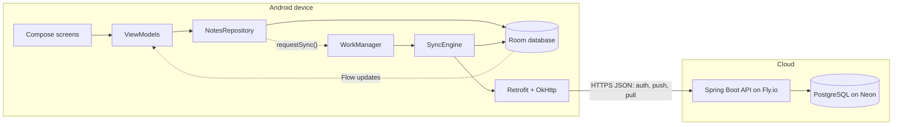
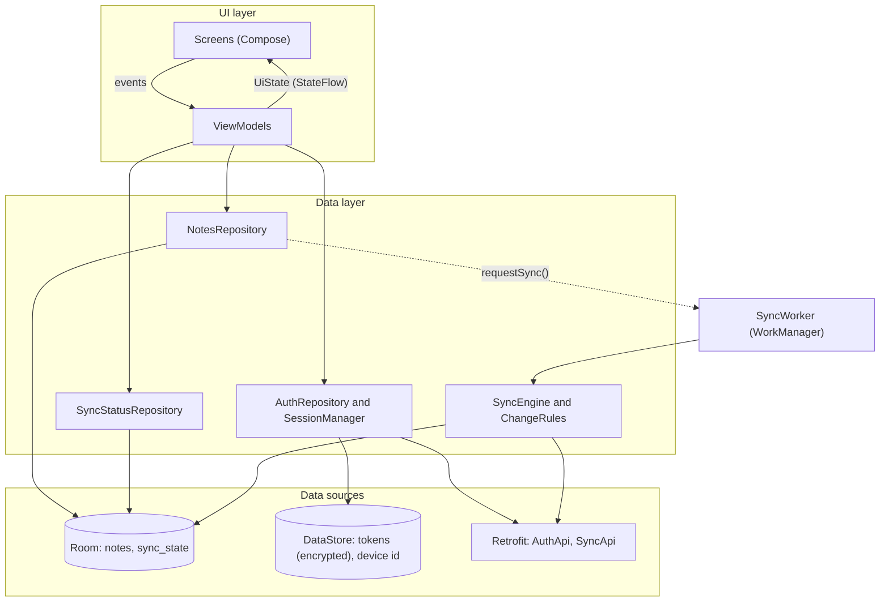
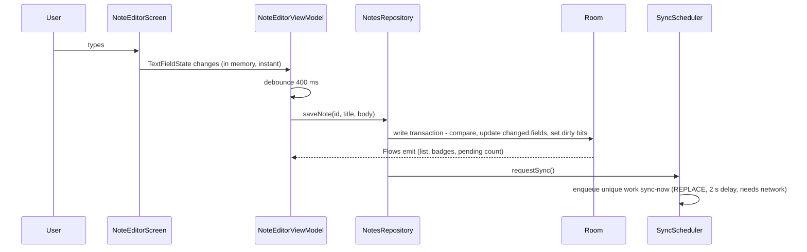
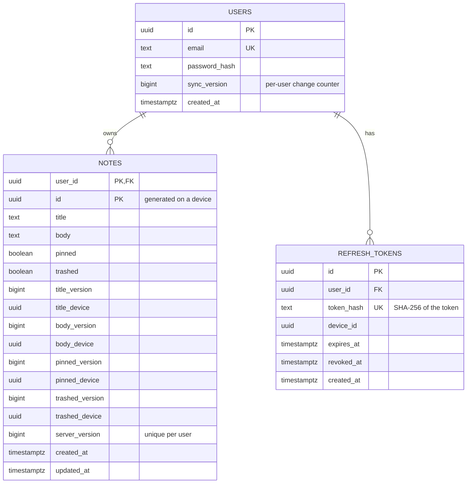
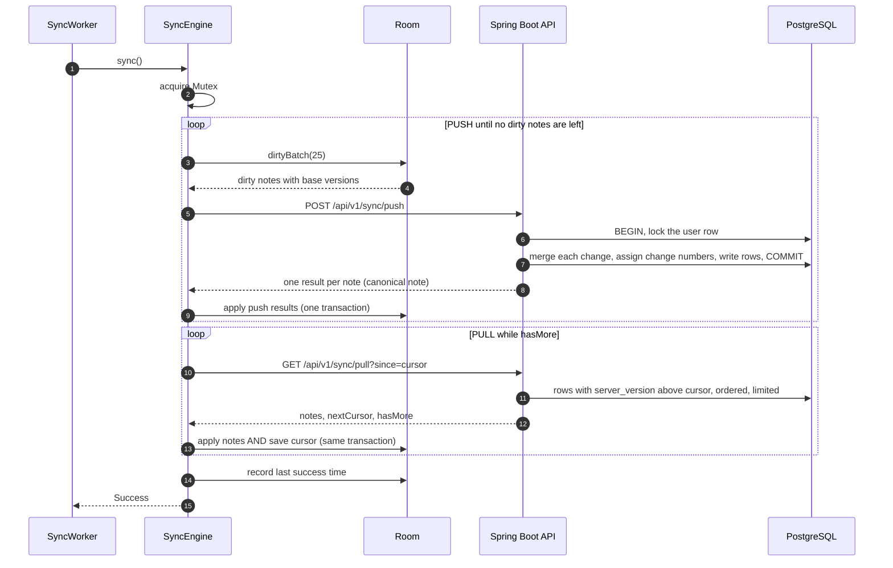
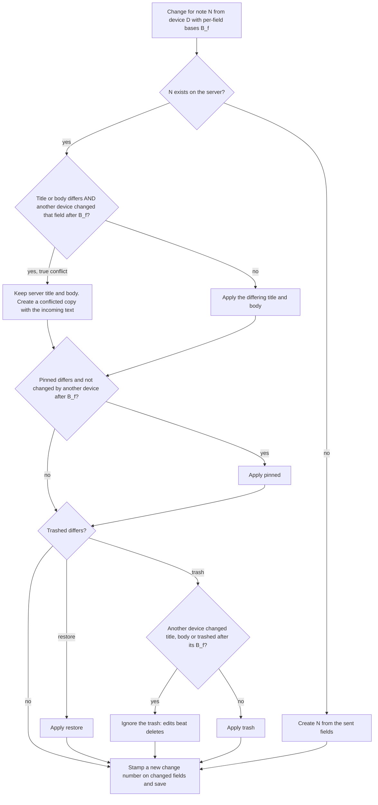
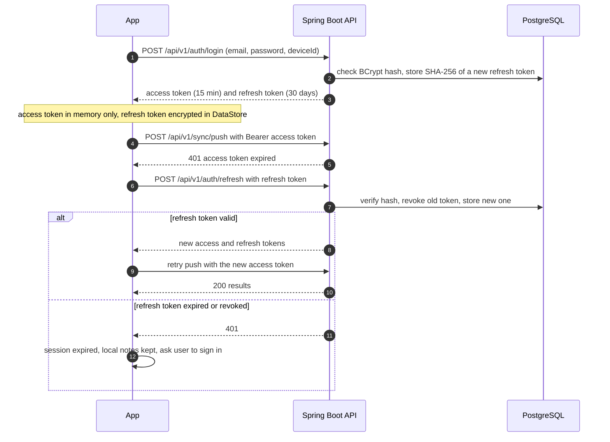
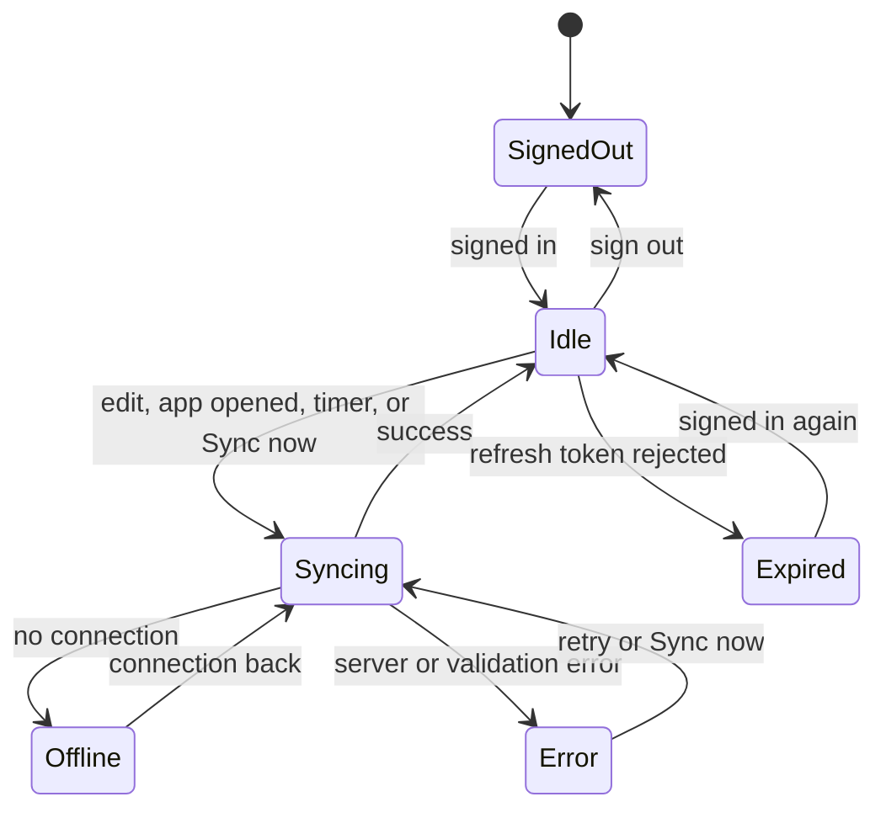
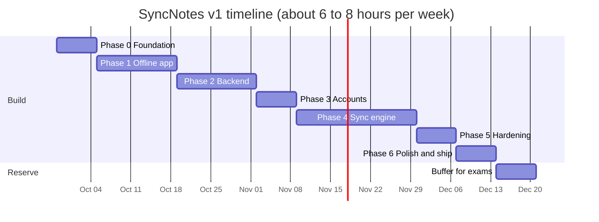
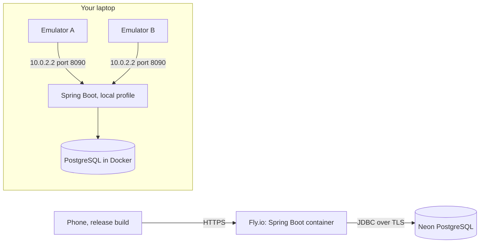

# SyncNotes: Architecture Blueprint

> **Document version:** 1.5 · **Created:** 2026-09-28 · **Updated:** 2026-10-27 · **Status:** Active, Phase 1 in progress
>
> **What this is:** the single source of truth for how SyncNotes v1 is designed and built, from an empty Android Studio project to a finished, portfolio-ready app with a backend.
>
> **Living document:** when the design changes, update this file in the same commit as the code and add an entry to the [Decision log](#15-decision-log).
>
> **Placeholders:** `syncnotes-api` stands for your Fly.io app name (not yet chosen). The Android package is `com.jezrel.syncnotes`.

---

## Table of contents

1. [How to use this document](#1-how-to-use-this-document)
2. [Product scope](#2-product-scope)
3. [Architecture principles](#3-architecture-principles)
4. [System overview](#4-system-overview)
5. [Repository and code structure](#5-repository-and-code-structure)
6. [Android app architecture](#6-android-app-architecture)
7. [Local data model](#7-local-data-model)
8. [Backend and API](#8-backend-and-api)
9. [Sync protocol](#9-sync-protocol)
10. [Authentication and security](#10-authentication-and-security)
11. [Sync status, errors and observability](#11-sync-status-errors-and-observability)
12. [Testing strategy](#12-testing-strategy)
13. [Build plan](#13-build-plan)
14. [Environments, deployment and CI](#14-environments-deployment-and-ci)
15. [Decision log](#15-decision-log)
16. [After v1](#16-after-v1)
17. [Glossary](#17-glossary)
- [Appendix A. Definition of done](#appendix-a-definition-of-done)
- [Appendix B. References](#appendix-b-references)

---

## 1. How to use this document

### 1.1 Progress tracker

Update this table at the end of each phase.

| Phase | Target dates | Status | Git tag |
|---|---|---|---|
| 0. Foundation | Sep 28 – Oct 4 | Done (merged to main) | — |
| 1. Offline notes app | Oct 5 – Oct 18 | Code complete; awaiting on-device check of exit criteria | `v0.1-offline` |
| 2. Backend | Oct 19 – Nov 1 | In progress (2.1–2.5 done) | `v0.2-backend` |
| 3. Accounts on Android | Nov 2 – Nov 8 | Not started | `v0.3-auth` |
| 4. Sync engine | Nov 9 – Nov 29 | Not started | `v0.4-sync` |
| 5. Hardening | Nov 30 – Dec 6 | Not started | `v0.5-rc` |
| 6. Polish and ship | Dec 7 – Dec 13 | Not started | `v1.0` |
| Buffer (exams, slippage) | Dec 14 – Dec 20 | — | — |

The dates assume about 6–8 hours of work per week. If a phase slips, move the dates, not the exit criteria.

### 1.2 Routine for every work session

1. Open [§13 Build plan](#13-build-plan) and find the next unchecked step in the current phase.
2. Re-read the section of this document that the step points to.
3. For anything non-trivial, sketch first: a few lines in `TODO.md` describing what you'll change and how you'll test it.
4. Code, test, commit. Tick the checkbox in §13 in the same commit.
5. Write anything surprising or hard-won in `LEARNINGS.md` (it becomes README material and interview stories).

### 1.3 Rules

- **R1.** Don't start a phase until the previous phase's exit criteria are met.
- **R2.** Design changes go into this document in the same commit as the code, with a Decision log entry.
- **R3.** The merge rules in [§9.4](#94-merge-rules-the-contract) are the contract between the app and the server. Any change to them needs matching tests on both sides, and the same change in `docs/sync_protocol_model.py`.
- **R4.** Never ship code that can silently lose user text. When unsure, keep both versions.

### 1.4 Reading the diagrams

Diagrams use [Mermaid](https://mermaid.js.org/). They render automatically on GitHub. To see them in Android Studio, enable Mermaid under **Settings → Languages & Frameworks → Markdown**.

---

## 2. Product scope

**One-liner:** SyncNotes is a markdown notes app that works fully offline and keeps notes in sync across devices without ever losing an edit.

### 2.1 v1 features

- Create, edit and search notes (title plus markdown body), with an edit/preview toggle
- Pin notes, move notes to trash, restore from trash
- Works 100% offline, and every change is saved on the device immediately
- Optional account (email and password). When signed in, notes sync across all devices on that account
- Automatic background sync, plus a "Sync now" button
- Sync status for the whole app and for each note (synced, pending, error)
- Conflict handling that never loses text: changes merge when possible, otherwise the losing text becomes a "conflicted copy" note

### 2.2 Not in v1

Real-time collaboration, sharing notes with other people, images and attachments, tags or folders, permanently emptying the trash, web or iOS clients, and end-to-end encryption. See [§16](#16-after-v1) for how these would fit later.

### 2.3 Quality targets

| Area | Target |
|---|---|
| Durability | Text is saved to the device within 0.5 s of the last keystroke and survives the app being killed |
| Offline | Everything except signing in works in airplane mode |
| Correctness | No lost text in any scenario of the conflict matrix ([§12.3](#123-conflict-matrix)) |
| Startup | The note list appears from local data without waiting for the network |
| Scale | Smooth scrolling and search with 2,000 notes. First sync of 2,000 notes in under 30 s on normal Wi-Fi |
| Battery and data | Background sync at most every 15 minutes. Only changed notes are transferred |

---

## 3. Architecture principles

| # | Principle | What it means in practice |
|---|---|---|
| P1 | The local database is the UI's source of truth | Screens only read from Room. Network results are written into Room, and the UI updates from there. |
| P2 | The network is optional | Nothing in the UI waits for a request. Sync runs in the background. |
| P3 | The server orders changes, not device clocks | Conflicts are detected with server-assigned version numbers. Device timestamps are only for display and sorting. |
| P4 | Every sync step is safe to repeat or interrupt | Pushing the same change twice is harmless. The pull cursor is saved in the same transaction as the data it covers. |
| P5 | Never silently lose text | When two edits truly conflict, the losing text becomes its own note. |
| P6 | Rules are pure functions | The server's merge rules and the app's apply rules are plain code with no I/O, so every case can be unit-tested. |
| P7 | Boring tech everywhere except the sync | Standard Jetpack and Spring choices, so the effort goes into the interesting part. |

---

## 4. System overview

### 4.1 Context diagram



The key idea: the UI never talks to the network. The user edits Room, Room updates the UI, and the SyncEngine moves changes between Room and the server in the background.

### 4.2 Components

| Component | Runs on | Responsibility |
|---|---|---|
| Compose screens and ViewModels | Phone | Rendering, UI state, user input |
| `NotesRepository` | Phone | All note reads and writes. Marks changed fields as dirty and asks for a sync |
| Room database | Phone | Notes and sync bookkeeping (cursor, last sync result) |
| `SyncEngine` + `ChangeRules` | Phone | Pushes dirty notes, pulls server changes, applies results to Room |
| `SyncWorker` (WorkManager) | Phone | Runs the SyncEngine in the background with network constraints and retries |
| `SessionManager`, `TokenStore` | Phone | Signed-in state, tokens, refresh |
| Spring Boot API | Fly.io | Accounts and tokens, push and pull endpoints, merge rules |
| PostgreSQL | Neon | Users, notes, refresh tokens |

### 4.3 Tech stack

Exact versions are pinned in `gradle/libs.versions.toml` and `server/pom.xml`, chosen as the latest stable releases at setup time.

**Android app**

| Concern | Choice | Why |
|---|---|---|
| Language and UI | Kotlin, Jetpack Compose, Material 3 | Current standard for Android |
| Navigation | Navigation 3 (`androidx.navigation3`) | Stable since November 2025 and Google's recommended navigation for Compose. The back stack is ordinary state you own |
| Dependency injection | Hilt (with KSP) | Standard. Integrates with ViewModels and WorkManager |
| Local database | Room 2.8 (`androidx.room`, KSP) | `androidx.room3` (Room 3) is unpublished, so this uses the Room 2.8.5 fallback (ADR-014); still coroutine-first and matches this design |
| Small key-value data | DataStore (Preferences) | Async replacement for SharedPreferences |
| Background work | WorkManager | Survives restarts, handles network constraints and backoff |
| Networking | Retrofit, OkHttp, kotlinx.serialization | Well documented. OkHttp's `Authenticator` handles token refresh |
| Markdown preview | `multiplatform-markdown-renderer` (Material 3 artifact) | Maintained Compose markdown renderer |
| Secret storage | Android Keystore (AES-GCM) + DataStore | `EncryptedSharedPreferences` is deprecated |
| Tests | JUnit, kotlinx-coroutines-test, Turbine, MockWebServer, Compose UI test | Standard |

**Backend**

| Concern | Choice | Why |
|---|---|---|
| Language | Java 21 | Familiar, LTS |
| Framework | Spring Boot 4.1.x | Current release line. Open-source support for 3.5 ended in June 2026 |
| Data access | `JdbcClient` + Flyway | Sync needs explicit SQL and row locks. JPA's caching and dirty checking get in the way |
| Database | PostgreSQL on Neon | Managed, free tier, already familiar |
| Auth | Spring Security (OAuth2 Resource Server with JWT), BCrypt | Standard and stateless |
| Rate limiting | Bucket4j | Protects the auth endpoints |
| Tests | JUnit 5, Testcontainers (real PostgreSQL) | Tests run against the same database engine as production |
| Hosting | Docker on Fly.io | Same pipeline as webHookDebugger |

---

## 5. Repository and code structure

### 5.1 Repository layout

One repository holds everything: the Android app lives at the repository root (so this folder is the Android Studio project), and the server and docs sit alongside it in their own folders. The whole system is visible from a single GitHub page.

```
syncNote/                           <- git repository root AND the Android Studio project (open THIS folder)
├── app/
│   ├── schemas/                    <- exported Room schema JSON (committed)
│   └── src/
│       ├── main/
│       ├── debug/                  <- debug-only resources (network security config)
│       ├── test/                   <- JVM unit tests
│       └── androidTest/            <- instrumented tests (Room, Compose UI)
├── gradle/
│   ├── libs.versions.toml
│   └── wrapper/
├── build.gradle.kts
├── settings.gradle.kts             <- includes :app
├── gradlew, gradlew.bat
├── gradle.properties
├── server/                         <- Spring Boot project (Maven), independent of the Gradle build
│   ├── src/main/java/...
│   ├── src/main/resources/
│   │   ├── application.yml
│   │   └── db/migration/           <- Flyway SQL files
│   ├── src/test/java/...
│   ├── compose.yaml                <- local PostgreSQL
│   ├── Dockerfile
│   └── fly.toml
├── docs/
│   ├── sync_protocol_model.py      <- executable model of the sync rules (section 9)
│   ├── TESTING.md                  <- two-emulator test script and results
│   └── api.http                    <- runnable API requests (VS Code REST Client)
├── .github/workflows/              <- android.yml, server.yml
├── .gitattributes
├── .gitignore
├── ARCHITECTURE.md                 <- this file (at the repo root)
├── README.md
├── LEARNINGS.md
└── TODO.md
```

The Android Gradle build (root `settings.gradle.kts`, which includes only `:app`) and the server's Maven build are independent; the `server/` folder is not part of the Gradle project.

### 5.2 Android packages

```
app/src/main/java/com/jezrel/syncnotes/
├── SyncNotesApp.kt                 # @HiltAndroidApp, WorkManager config, foreground sync trigger
├── MainActivity.kt                 # single activity, hosts NavDisplay
├── core/
│   ├── di/                         # Hilt modules (Database, Network, Coroutines, Work, App)
│   ├── device/DeviceInfo.kt        # device id (random UUID per install) and device name
│   ├── time/Clock.kt               # injectable clock, so tests control time
│   └── network/NetworkMonitor.kt   # online/offline as a Flow
├── data/
│   ├── local/                      # SyncNotesDatabase, entities, DAOs, DirtyField
│   ├── remote/                     # AuthApi, SyncApi, DTOs, AuthInterceptor, TokenAuthenticator
│   └── repository/                 # NotesRepository, AuthRepository, SyncStatusRepository
├── auth/                           # SessionManager, TokenStore
├── sync/                           # SyncEngine, ChangeRules, SyncWorker, SyncScheduler
└── ui/
    ├── navigation/                 # NavKeys, SyncNotesNavDisplay
    ├── theme/
    ├── components/                 # SyncBadge, MarkdownPreview, EmptyState, ...
    ├── noteslist/                  # NotesListScreen, NotesListViewModel, NotesListUiState
    ├── editor/                     # NoteEditorScreen, NoteEditorViewModel
    ├── trash/
    ├── signin/
    └── settings/                   # includes the debug panel (debug builds only)
```

### 5.3 Server packages

```
server/src/main/java/com/jezrel/syncnotes/
├── SyncNotesApplication.java
├── config/
│   ├── SecurityConfig.java         # stateless JWT resource server; /api/v1/auth/** is public
│   ├── JwtConfig.java              # HS256 JwtEncoder and JwtDecoder beans
│   └── RateLimitConfig.java        # Bucket4j limits for /api/v1/auth/**
├── auth/
│   ├── AuthController.java         # register, login, refresh, logout
│   ├── AuthService.java
│   ├── TokenService.java           # access JWTs, refresh token rotation
│   ├── RefreshTokenRepository.java
│   └── dto/
├── user/
│   ├── MeController.java           # GET /api/v1/me
│   └── UserRepository.java
├── sync/
│   ├── SyncController.java         # push, pull
│   ├── SyncService.java            # transactions, locking, version numbers
│   ├── MergeEngine.java            # PURE: the rules in section 9.4 (no Spring, no SQL)
│   ├── NoteRepository.java         # JdbcClient SQL
│   └── dto/
└── common/
    └── ApiExceptionHandler.java    # errors as Problem Details (RFC 9457)
```

### 5.4 Conventions

- **Commits:** [Conventional Commits](https://www.conventionalcommits.org/): `feat(editor): autosave`, `fix(sync): keep base version for dirty notes`, `test(merge): conflict copy cases`, `docs: update blueprint`.
- **Branches:** `main` always builds and passes tests. Work on short-lived branches named after the step, like `p1/editor-autosave`.
- **Tags:** one per phase (see the progress tracker).
- **IDs:** UUIDs everywhere, as lowercase canonical strings.
- **Time:** epoch milliseconds (`Long`) on the phone, `timestamptz` in PostgreSQL, ISO-8601 UTC strings in JSON.
- **Kotlin:** no business logic in composables. Everything below the ViewModel is main-safe (`suspend` or `Flow`).

---

## 6. Android app architecture

### 6.1 Layers



Rules for the layers:

1. Composables receive state and callbacks. They never call repositories.
2. Each ViewModel exposes one `StateFlow<XxxUiState>` plus plain functions for events.
3. Only repositories touch DAOs. Only the `SyncEngine` calls `SyncApi`.
4. Anything that must outlive a screen (the final autosave, sign-out cleanup) runs in an injected `@ApplicationScope` coroutine scope.

### 6.2 UI state pattern

```kotlin
data class NotesListUiState(
    val notes: List<NoteSummary> = emptyList(),
    val sync: SyncStatus = SyncStatus.SignedOut,
    val loading: Boolean = true,
)

@HiltViewModel
class NotesListViewModel @Inject constructor(
    private val notes: NotesRepository,
    syncStatus: SyncStatusRepository,
) : ViewModel() {

    // Text in the search box is Compose state, updated synchronously (no cursor jumps).
    var query by mutableStateOf("")
        private set

    @OptIn(FlowPreview::class, ExperimentalCoroutinesApi::class)
    val uiState: StateFlow<NotesListUiState> =
        combine(
            snapshotFlow { query }.debounce(250).flatMapLatest { notes.observeActive(it) },
            syncStatus.status,
        ) { list, sync -> NotesListUiState(notes = list, sync = sync, loading = false) }
            .stateIn(viewModelScope, SharingStarted.WhileSubscribed(5_000), NotesListUiState())

    fun onQueryChange(value: String) { query = value }

    fun onTogglePin(id: String, pinned: Boolean) {
        viewModelScope.launch { notes.setPinned(id, pinned) }
    }
}
```

### 6.3 Navigation (Navigation 3)

Every screen is a `@Serializable` key. The back stack is a list of keys that you add to and remove from.

```kotlin
@Serializable data object NotesList : NavKey
@Serializable data class NoteEditor(val noteId: String, val isNew: Boolean = false) : NavKey
@Serializable data object Trash : NavKey
@Serializable data object Settings : NavKey
@Serializable data object SignIn : NavKey

@Composable
fun SyncNotesNavDisplay() {
    val backStack = rememberNavBackStack(NotesList)

    NavDisplay(
        backStack = backStack,
        onBack = { backStack.removeLastOrNull() },
        entryDecorators = listOf(
            rememberSaveableStateHolderNavEntryDecorator(),
            rememberViewModelStoreNavEntryDecorator(),   // ViewModels live as long as their entry
        ),
        entryProvider = entryProvider {
            entry<NotesList> {
                NotesListScreen(
                    onOpenNote = { id -> backStack.add(NoteEditor(id)) },
                    onNewNote = { backStack.add(NoteEditor(UUID.randomUUID().toString(), isNew = true)) },
                    onOpenTrash = { backStack.add(Trash) },
                    onOpenSettings = { backStack.add(Settings) },
                )
            }
            entry<NoteEditor> { key ->
                val vm = hiltViewModel<NoteEditorViewModel, NoteEditorViewModel.Factory>(
                    creationCallback = { factory -> factory.create(key) }
                )
                NoteEditorScreen(vm, onBack = { backStack.removeLastOrNull() })
            }
            entry<Trash> { TrashScreen(onBack = { backStack.removeLastOrNull() }) }
            entry<Settings> {
                SettingsScreen(
                    onSignIn = { backStack.add(SignIn) },
                    onBack = { backStack.removeLastOrNull() },
                )
            }
            entry<SignIn> { SignInScreen(onDone = { backStack.removeLastOrNull() }) }
        },
    )
}
```

Artifacts involved: `navigation3-runtime`, `navigation3-ui`, `lifecycle-viewmodel-navigation3` (for `rememberViewModelStoreNavEntryDecorator`), and `hilt-lifecycle-viewmodel-compose` (for `hiltViewModel` with a creation callback).

Signing in is never forced. The app opens on the note list whether or not there is an account.

### 6.4 Screens

| Screen | Key | What it shows and does | Phase |
|---|---|---|---|
| Notes list | `NotesList` | Search box. Pinned notes first, then by last edit. Sync badge per note, sync status line. New-note button. Menu with Trash and Settings | 1 (sync UI in 4) |
| Note editor | `NoteEditor` | Title and body fields, edit/preview toggle, pin, move to trash. Saves automatically | 1 |
| Trash | `Trash` | Trashed notes with a read-only preview and a Restore action | 1 |
| Sign in | `SignIn` | Email and password, switch between sign in and create account, error messages | 3 |
| Settings | `Settings` | Account (email, sign out), Sync now and last sync time, theme, app version, debug panel in debug builds | 3–4 |

### 6.5 Editor and autosave

Rules:

1. Editor text lives in the ViewModel as Compose `TextFieldState`, not a `StateFlow`. Async text updates cause cursor jumps.
2. A new note has an id from the moment the editor opens, but its database row is only created on the first save with non-blank text. Opening and leaving a blank note creates nothing.
3. Saving happens 400 ms after typing stops.
4. When the screen closes, any pending save is flushed in the application scope so it isn't cancelled with the ViewModel.
5. The repository compares new values with stored ones and marks only changed fields as dirty.
6. Trashed notes are read-only. Restore first, then edit.
7. The UI enforces the same limits as the server: title up to 300 characters, body up to 100,000.

```kotlin
@OptIn(FlowPreview::class)
@HiltViewModel(assistedFactory = NoteEditorViewModel.Factory::class)
class NoteEditorViewModel @AssistedInject constructor(
    @Assisted private val key: NoteEditor,
    private val notes: NotesRepository,
    @ApplicationScope private val appScope: CoroutineScope,
) : ViewModel() {

    @AssistedFactory
    interface Factory { fun create(key: NoteEditor): NoteEditorViewModel }

    val title = TextFieldState()
    val body = TextFieldState()

    init {
        viewModelScope.launch {
            if (!key.isNew) {
                notes.getNote(key.noteId)?.let {
                    title.setTextAndPlaceCursorAtEnd(it.title)
                    body.setTextAndPlaceCursorAtEnd(it.body)
                }
            }
            snapshotFlow { title.text.toString() to body.text.toString() }
                .drop(1)                 // skip the values we just loaded
                .debounce(400)
                .collect { (t, b) -> notes.saveNote(key.noteId, t, b) }
        }
    }

    override fun onCleared() {
        val t = title.text.toString()
        val b = body.text.toString()
        appScope.launch { notes.saveNote(key.noteId, t, b) }   // no-op if nothing changed
    }
}
```

### 6.6 Dependency injection

| Hilt module | Provides |
|---|---|
| `DatabaseModule` | `SyncNotesDatabase` (Room 2.8, default framework SQLite — no `setDriver`), `NoteDao`, `SyncStateDao` |
| `NetworkModule` | `Json`, `OkHttpClient` (auth interceptor, authenticator, timeouts, debug logging), `Retrofit`, `AuthApi`, `SyncApi`, plus a second plain client used only for token refresh |
| `CoroutinesModule` | `@ApplicationScope CoroutineScope` (`SupervisorJob()` + `Dispatchers.Default`), `@IoDispatcher` |
| `WorkModule` | `WorkManager` |
| `AppModule` | `Clock`, `DeviceInfo`, DataStore instances (`settings`, `auth`) |
| `RepositoryModule` | `NotesRepository` → `RoomNotesRepository` (`@Binds`, singleton). The interface lets ViewModel tests use a fake |
| `SyncModule` | `SyncScheduler` → `NoOpSyncScheduler` in Phase 1; replaced by the WorkManager scheduler in Phase 4 |

### 6.7 Threading

- Room `suspend` functions and `Flow`s are main-safe, so repositories don't switch dispatchers for database work.
- Crypto and file work runs on `@IoDispatcher`.
- `SyncEngine.sync()` is guarded by a `Mutex`, so only one sync runs at a time in the process.

---

## 7. Local data model

### 7.1 Entities (Room)

```kotlin
@Entity(
    tableName = "notes",
    indices = [Index("trashed", "pinned", "updated_at"), Index("dirty_fields")],
)
data class NoteEntity(
    @PrimaryKey val id: String,                                    // UUID, generated on a device
    val title: String,
    val body: String,
    val pinned: Boolean,
    val trashed: Boolean,
    @ColumnInfo(name = "created_at") val createdAt: Long,         // epoch ms, display only
    @ColumnInfo(name = "updated_at") val updatedAt: Long,         // epoch ms, display and sorting only
    @ColumnInfo(name = "server_version") val serverVersion: Long, // latest note version seen; 0 = never synced
    @ColumnInfo(name = "dirty_fields") val dirtyFields: Int,      // bitmask, see DirtyField
    @ColumnInfo(name = "sync_error") val syncError: String?,      // set when the server rejected this note
    // Per-field base versions (ADR-018): the server version of each field this device last saw.
    @ColumnInfo(name = "title_base") val titleBase: Long = 0,
    @ColumnInfo(name = "body_base") val bodyBase: Long = 0,
    @ColumnInfo(name = "pinned_base") val pinnedBase: Long = 0,
    @ColumnInfo(name = "trashed_base") val trashedBase: Long = 0,
)

object DirtyField {
    const val TITLE = 1
    const val BODY = 2
    const val PINNED = 4
    const val TRASHED = 8
    const val ALL = TITLE or BODY or PINNED or TRASHED
}

fun Int.has(flag: Int): Boolean = (this and flag) != 0

@Entity(tableName = "sync_state")
data class SyncStateEntity(
    @PrimaryKey val id: Int = 0,                                     // always a single row
    @ColumnInfo(name = "account_id") val accountId: String? = null,  // whose notes are on this device
    val cursor: Long = 0,                                            // highest server version pulled
    @ColumnInfo(name = "last_success_at") val lastSuccessAt: Long? = null,
    @ColumnInfo(name = "last_error") val lastError: String? = null,
)
```

> The four `*_base` columns arrive with the sync engine in Phase 4 as **schema v2** (an auto-migration from v1, defaulting to 0, plus a migration test). Phase 1 shipped schema v1 without them, and nothing reads them until then.

### 7.2 Why these columns exist

| Column | Purpose |
|---|---|
| `title_base`, `body_base`, `pinned_base`, `trashed_base` | The **base versions**: for each field, the server version of that field this device last saw. All four are sent with every push, so the server can tell, field by field, whether another device changed it since ([§9.4](#94-merge-rules-the-contract), ADR-018). |
| `server_version` | The latest version of the whole note this device has seen. Used only to skip stale pull pages; conflict detection uses the per-field bases. |
| `dirty_fields` | Which fields changed on this device and haven't been confirmed by the server. Only those fields are pushed, which is what makes per-field merging possible. |
| `sync_error` | A note the server rejected (for example, too long) isn't retried forever. Editing the note clears the error. |
| `sync_state.cursor` | Where the next pull starts. Saved in the same transaction as the pulled notes. |
| `sync_state.account_id` | Detects a different account signing in, so notes from two accounts never mix. |

Dirty bits:

| Bit | Field | Set when | Cleared when |
|---|---|---|---|
| 1 | title | A local edit changes the title | A push response arrives and the local title still equals what was sent |
| 2 | body | A local edit changes the body | Same, for the body |
| 4 | pinned | The user pins or unpins | Same, for pinned |
| 8 | trashed | The user trashes or restores | Same, for trashed |

A brand-new note has all four bits set, `server_version = 0` and every base 0.

### 7.3 DAOs

```kotlin
data class NoteSummary(
    val id: String,
    val title: String,
    val preview: String,
    val pinned: Boolean,
    val updatedAt: Long,
    val dirtyFields: Int,
    val syncError: String?,
)

@Dao
interface NoteDao {

    // List screen: summaries only (no full bodies), so scrolling stays fast.
    // `query` must already be escaped: %, _ and \ prefixed with \ (done in NotesRepository).
    @Query("""
        SELECT id, title, substr(body, 1, 200) AS preview, pinned,
               updated_at AS updatedAt, dirty_fields AS dirtyFields, sync_error AS syncError
        FROM notes
        WHERE trashed = 0
          AND (:query = ''
               OR title LIKE '%' || :query || '%' ESCAPE '\'
               OR body  LIKE '%' || :query || '%' ESCAPE '\')
        ORDER BY pinned DESC, updated_at DESC
    """)
    fun observeActive(query: String): Flow<List<NoteSummary>>

    @Query("SELECT * FROM notes WHERE trashed = 1 ORDER BY updated_at DESC")
    fun observeTrash(): Flow<List<NoteEntity>>

    @Query("SELECT * FROM notes WHERE id = :id")
    suspend fun get(id: String): NoteEntity?

    @Query("SELECT * FROM notes WHERE dirty_fields != 0 AND sync_error IS NULL LIMIT :limit")
    suspend fun dirtyBatch(limit: Int): List<NoteEntity>

    @Query("SELECT COUNT(*) FROM notes WHERE dirty_fields != 0")
    fun observePendingCount(): Flow<Int>

    @Upsert suspend fun upsert(note: NoteEntity)

    @Upsert suspend fun upsertAll(notes: List<NoteEntity>)

    @Query("DELETE FROM notes")
    suspend fun deleteAll()
}

@Dao
interface SyncStateDao {
    @Query("SELECT * FROM sync_state WHERE id = 0")
    suspend fun get(): SyncStateEntity?        // null means "defaults"

    @Query("SELECT * FROM sync_state WHERE id = 0")
    fun observe(): Flow<SyncStateEntity?>

    @Upsert suspend fun upsert(state: SyncStateEntity)
}
```

Search uses `LIKE` in v1. That's fast enough for a few thousand notes. Full-text search (FTS) is a post-v1 upgrade ([§16](#16-after-v1)).

### 7.4 Local write path



```kotlin
suspend fun saveNote(id: String, title: String, body: String) {
    val changed = db.withTransaction {
        val now = clock.nowMillis()
        val existing = noteDao.get(id)
        when {
            existing == null && title.isBlank() && body.isBlank() -> false  // nothing typed yet
            existing == null -> {
                noteDao.upsert(
                    NoteEntity(
                        id = id, title = title, body = body, pinned = false, trashed = false,
                        createdAt = now, updatedAt = now, serverVersion = 0,
                        dirtyFields = DirtyField.ALL, syncError = null,
                    )
                )
                true
            }
            existing.title == title && existing.body == body -> false       // no change
            else -> {
                var dirty = existing.dirtyFields
                if (existing.title != title) dirty = dirty or DirtyField.TITLE
                if (existing.body != body) dirty = dirty or DirtyField.BODY
                noteDao.upsert(
                    existing.copy(title = title, body = body, updatedAt = now,
                                  dirtyFields = dirty, syncError = null)
                )
                true
            }
        }
    }
    if (changed) syncScheduler.requestSync()
}
```

`setPinned`, `moveToTrash` and `restore` follow the same pattern: update one field, set its dirty bit, request a sync.

### 7.5 Database setup and migrations

```kotlin
@Database(entities = [NoteEntity::class, SyncStateEntity::class], version = 1, exportSchema = true)
abstract class SyncNotesDatabase : RoomDatabase() {
    abstract fun noteDao(): NoteDao
    abstract fun syncStateDao(): SyncStateDao
}

// DatabaseModule (Room 2.8.5 fallback — see ADR-014)
@Provides @Singleton
fun provideDatabase(@ApplicationContext context: Context): SyncNotesDatabase =
    Room.databaseBuilder(context, SyncNotesDatabase::class.java, "syncnotes.db")
        .build()   // no setDriver: default framework SQLite, which Robolectric shadows and room-ktx targets
```

- Export the schema with the Room Gradle plugin (`room { schemaDirectory("$projectDir/schemas") }`, plugin id `androidx.room`) and commit the JSON files.
- Every schema change bumps the version and adds an auto-migration (or a manual `Migration`) with a migration test.
- **Never** use a destructive fallback migration. It would delete unsynced notes.

Room version note: this project uses the **Room 2.8.5** fallback (ADR-014; `androidx.room3` is unpublished). So packages are `androidx.room.*`, no driver is set (the default framework SQLite path is the one Robolectric shadows and that `room-ktx`'s `withTransaction` targets), coroutine transactions use `withTransaction { }` (from `room-ktx`), and type converters would be `@TypeConverter` — this design needs none. If/when Room 3 ships, switch to `androidx.room3.*`, an explicit `setDriver(AndroidSQLiteDriver())`, and `withWriteTransaction { }`.

---

## 8. Backend and API

### 8.1 Database schema



`server/src/main/resources/db/migration/V1__init.sql`:

```sql
CREATE TABLE users (
    id            UUID        PRIMARY KEY,
    email         TEXT        NOT NULL UNIQUE,        -- stored lowercased
    password_hash TEXT        NOT NULL,
    sync_version  BIGINT      NOT NULL DEFAULT 0,     -- per-user change counter (section 9.3)
    created_at    TIMESTAMPTZ NOT NULL DEFAULT now()
);

CREATE TABLE notes (
    user_id         UUID        NOT NULL REFERENCES users (id) ON DELETE CASCADE,
    id              UUID        NOT NULL,             -- generated on a device
    title           TEXT        NOT NULL,
    body            TEXT        NOT NULL,
    pinned          BOOLEAN     NOT NULL,
    trashed         BOOLEAN     NOT NULL,
    -- per field: the change number of its last write, and which device wrote it
    title_version   BIGINT      NOT NULL,
    title_device    UUID        NOT NULL,
    body_version    BIGINT      NOT NULL,
    body_device     UUID        NOT NULL,
    pinned_version  BIGINT      NOT NULL,
    pinned_device   UUID        NOT NULL,
    trashed_version BIGINT      NOT NULL,
    trashed_device  UUID        NOT NULL,
    server_version  BIGINT      NOT NULL,             -- change number of the latest write to this row
    created_at      TIMESTAMPTZ NOT NULL,             -- reported by the creating device
    updated_at      TIMESTAMPTZ NOT NULL,             -- server time of the latest write
    PRIMARY KEY (user_id, id),
    CONSTRAINT notes_title_len CHECK (char_length(title) <= 300),
    CONSTRAINT notes_body_len  CHECK (char_length(body) <= 100000)
);

-- Serves the pull query and guarantees no two rows share a change number.
CREATE UNIQUE INDEX notes_user_version_idx ON notes (user_id, server_version);

CREATE TABLE refresh_tokens (
    id          UUID        PRIMARY KEY,
    user_id     UUID        NOT NULL REFERENCES users (id) ON DELETE CASCADE,
    token_hash  TEXT        NOT NULL UNIQUE,          -- the raw token is never stored
    device_id   UUID        NOT NULL,
    expires_at  TIMESTAMPTZ NOT NULL,
    revoked_at  TIMESTAMPTZ,
    created_at  TIMESTAMPTZ NOT NULL DEFAULT now()
);

CREATE INDEX refresh_tokens_user_idx ON refresh_tokens (user_id);
```

Design notes:

- The primary key of `notes` is `(user_id, id)`. Two accounts can never collide or interfere, even if a client sends another account's note id.
- There are no hard deletes. A trashed note is a normal row with `trashed = true`, so other devices learn about the deletion through a normal pull.

### 8.2 Endpoints

| Method | Path | Auth | Purpose |
|---|---|---|---|
| POST | `/api/v1/auth/register` | Public | Create an account, returns tokens |
| POST | `/api/v1/auth/login` | Public | Returns tokens |
| POST | `/api/v1/auth/refresh` | Refresh token in body | Returns a new token pair and revokes the old refresh token |
| POST | `/api/v1/auth/logout` | Refresh token in body | Revokes the refresh token |
| GET | `/api/v1/me` | Bearer | Current user id and email |
| POST | `/api/v1/sync/push` | Bearer | Upload changes |
| GET | `/api/v1/sync/pull?since={cursor}&limit={n}` | Bearer | Download changes after the cursor |
| GET | `/actuator/health` | Public | Health check for Fly.io |

### 8.3 Request and response shapes

**Register or login** (`POST /api/v1/auth/login`)

```json
{
  "email": "you@example.com",
  "password": "at least 8 characters",
  "deviceId": "0f8fad5b-d9cb-469f-a165-70867728950e"
}
```

```json
{
  "userId": "2b1c6f3e-8a44-4f0e-9a51-0d6f1c9e7b21",
  "email": "you@example.com",
  "accessToken": "eyJhbGciOiJIUzI1NiJ9...",
  "accessTokenExpiresIn": 900,
  "refreshToken": "hQ7fL2...base64url..."
}
```

**Push** (`POST /api/v1/sync/push`). Each change carries only the fields that are dirty on the device. A missing field means "not changed". `baseVersions` always carries all four fields: the version of each field the device last saw.

```json
{
  "deviceId": "0f8fad5b-d9cb-469f-a165-70867728950e",
  "deviceName": "Pixel 8",
  "changes": [
    {
      "id": "7c9e6679-7425-40de-944b-e07fc1f90ae7",
      "baseVersions": { "title": 41, "body": 38, "pinned": 40, "trashed": 12 },
      "createdAt": "2026-10-05T14:03:11Z",
      "body": "- eggs\n- rice\n- milk"
    },
    {
      "id": "3fa85f64-5717-4562-b3fc-2c963f66afa6",
      "baseVersions": { "title": 0, "body": 0, "pinned": 0, "trashed": 0 },
      "createdAt": "2026-10-06T09:12:40Z",
      "title": "Trip ideas",
      "body": "",
      "pinned": false,
      "trashed": false
    }
  ]
}
```

```json
{
  "results": [
    {
      "id": "7c9e6679-7425-40de-944b-e07fc1f90ae7",
      "status": "APPLIED",
      "note": {
        "id": "7c9e6679-7425-40de-944b-e07fc1f90ae7",
        "title": "Groceries",
        "body": "- eggs\n- rice\n- milk",
        "pinned": true,
        "trashed": false,
        "createdAt": "2026-10-05T14:03:11Z",
        "updatedAt": "2026-10-07T18:22:05Z",
        "fieldVersions": { "title": 41, "body": 57, "pinned": 44, "trashed": 12 },
        "version": 57
      }
    },
    {
      "id": "3fa85f64-5717-4562-b3fc-2c963f66afa6",
      "status": "APPLIED",
      "note": {
        "id": "3fa85f64-5717-4562-b3fc-2c963f66afa6",
        "title": "Trip ideas",
        "body": "",
        "pinned": false,
        "trashed": false,
        "createdAt": "2026-10-06T09:12:40Z",
        "updatedAt": "2026-10-07T18:22:05Z",
        "fieldVersions": { "title": 58, "body": 58, "pinned": 58, "trashed": 58 },
        "version": 58
      }
    }
  ]
}
```

Result statuses:

| Status | Meaning | `note` field |
|---|---|---|
| `APPLIED` | At least one field changed on the server | Canonical note after the merge |
| `NOOP` | Nothing needed to change (for example, a retry of a change the server already has) | Current server note |
| `CONFLICT_COPY` | True content conflict. The server kept its title and body and created a separate "conflicted copy" note with the incoming text | Current server note (the copy arrives on the next pull) |
| `REJECTED` | This note failed validation. Other notes in the request are unaffected | Absent. `error` explains why |

**Pull** (`GET /api/v1/sync/pull?since=41&limit=200`)

```json
{
  "notes": [
    {
      "id": "7c9e6679-7425-40de-944b-e07fc1f90ae7",
      "title": "Groceries",
      "body": "- eggs\n- rice\n- milk",
      "pinned": true,
      "trashed": false,
      "createdAt": "2026-10-05T14:03:11Z",
      "updatedAt": "2026-10-07T18:22:05Z",
      "fieldVersions": { "title": 41, "body": 57, "pinned": 44, "trashed": 12 },
      "version": 57
    }
  ],
  "nextCursor": 57,
  "hasMore": false
}
```

**Errors** use Problem Details (RFC 9457, Spring's `ProblemDetail`) plus a machine-readable `code`:

```json
{
  "type": "about:blank",
  "title": "Conflict",
  "status": 409,
  "detail": "An account with this email already exists.",
  "code": "EMAIL_TAKEN"
}
```

Codes: `EMAIL_TAKEN`, `INVALID_CREDENTIALS`, `TOKEN_INVALID`, `VALIDATION_FAILED`, `RATE_LIMITED`.

### 8.4 Validation and limits

| Rule | Limit | On violation |
|---|---|---|
| Changes per push | 1 to 50, no duplicate ids | 400 for the whole request |
| `id`, `deviceId` | Valid UUIDs | 400 |
| `baseVersions` | All four fields present, each 0 or more | 400 |
| `title` | Up to 300 characters | `REJECTED` for that note |
| `body` | Up to 100,000 characters | `REJECTED` for that note |
| `deviceName` | Up to 60 characters | Truncated |
| Pull `limit` | 1 to 500, default 200 | Clamped |
| Password | At least 8 characters | 400 |

The app pushes in batches of 25 notes, which keeps requests well under a few megabytes even with long notes.

### 8.5 Kotlin DTOs and API interfaces

```kotlin
@Serializable data class PushRequest(val deviceId: String, val deviceName: String, val changes: List<ChangeDto>)

@Serializable data class FieldVersions(val title: Long, val body: Long, val pinned: Long, val trashed: Long)

@Serializable data class ChangeDto(
    val id: String,
    val baseVersions: FieldVersions,   // all four, always sent (ADR-018)
    val createdAt: String,
    val title: String? = null,     // null = not changed (omitted from JSON)
    val body: String? = null,
    val pinned: Boolean? = null,
    val trashed: Boolean? = null,
)

@Serializable enum class PushStatus { APPLIED, NOOP, CONFLICT_COPY, REJECTED }

@Serializable data class PushResultDto(val id: String, val status: PushStatus, val note: NoteDto? = null, val error: String? = null)
@Serializable data class PushResponse(val results: List<PushResultDto>)

@Serializable data class NoteDto(
    val id: String, val title: String, val body: String, val pinned: Boolean, val trashed: Boolean,
    val createdAt: String, val updatedAt: String,
    val fieldVersions: FieldVersions, val version: Long,
)

@Serializable data class PullResponse(val notes: List<NoteDto>, val nextCursor: Long, val hasMore: Boolean)

interface SyncApi {
    @POST("api/v1/sync/push") suspend fun push(@Body request: PushRequest): PushResponse
    @GET("api/v1/sync/pull") suspend fun pull(@Query("since") since: Long, @Query("limit") limit: Int): PullResponse
}

// Json configuration shared by Retrofit
val json = Json { ignoreUnknownKeys = true; explicitNulls = false }

fun NoteEntity.toChangeDto() = ChangeDto(
    id = id,
    baseVersions = FieldVersions(titleBase, bodyBase, pinnedBase, trashedBase),
    createdAt = Instant.ofEpochMilli(createdAt).toString(),
    title = title.takeIf { dirtyFields.has(DirtyField.TITLE) },
    body = body.takeIf { dirtyFields.has(DirtyField.BODY) },
    pinned = pinned.takeIf { dirtyFields.has(DirtyField.PINNED) },
    trashed = trashed.takeIf { dirtyFields.has(DirtyField.TRASHED) },
)
```

On the server, the same shapes are Java records (for example `record ChangeDto(UUID id, FieldVersions baseVersions, Instant createdAt, String title, String body, Boolean pinned, Boolean trashed)`), where `null` means "not sent".

---

## 9. Sync protocol

This is the heart of the project. Read it fully before Phase 2.

The rules in §9.4 and §9.7 have an executable model in `docs/sync_protocol_model.py` (Python, no dependencies). It replays the worked examples, then runs randomized tests with several devices, lost requests and responses, stale pull pages, and edits made while a push is in flight, and checks four invariants: every device converges to the server, no typed text is lost, no conflicted copy is created against text the pushing device already had, and the system settles. A self-check first confirms the harness catches deliberately broken rules. If you change a rule, change the model and re-run it.

> **Status (2026-10-27): passing.** With the rules below, 1,000 randomized runs of 300 operations pass every invariant, as do 13,000 harder runs (up to 5 devices × 1,000 operations), and the three worked examples replay exactly. The first version of these rules (document v1.4, one base version per note) failed 141 of 1,000 runs. The model found two holes, and per-field base versions fixed them ([§9.12](#912-model-findings), ADR-018).

### 9.1 Vocabulary

| Term | Meaning |
|---|---|
| Change counter | `users.sync_version`. Goes up by one for every note row written for that user. |
| Server version | `notes.server_version`: the counter value when that note row last changed. Unique per user. |
| Field version, field device | For each field: the counter value of its last write, and the device that made it. |
| Base version | Per field, on the phone (`NoteEntity.titleBase` … `trashedBase`): the version of that field this device last saw. Sent for all four fields with every change. (`NoteEntity.serverVersion` is the note-level version, used only to skip stale pulls.) |
| Dirty fields | Fields changed on this device and not yet confirmed by the server. |
| Cursor | The highest server version this device has pulled. Stored in `sync_state`. |
| Device id | A random UUID generated once per app install. |
| Conflicted copy | A new note the server creates to hold incoming text that lost a true conflict. |

### 9.2 One sync cycle

Every sync is **push, then pull**.



Why push first: after the push, the server has already merged this device's edits, so the pull brings back the fully merged state, including any conflicted copies the push created.

### 9.3 Change numbers and why the server locks the user row

Every write gets the next number from the user's own counter. Pull then asks for "everything with a number above my cursor".

The trap this avoids: if numbers came from a global PostgreSQL sequence, two transactions could take numbers 101 and 102 and then **commit in the opposite order**. A device pulling in between would see 102, move its cursor to 102, and never see 101. That change would be lost for that device forever.

The fix is to take a row lock on the user before assigning numbers:

```sql
-- inside the push transaction
SELECT sync_version FROM users WHERE id = :userId FOR UPDATE;  -- a second push for this user waits here
-- ... merge; every row written gets counter + 1 ...
UPDATE users SET sync_version = :counter WHERE id = :userId;
-- COMMIT releases the lock
```

Pushes for the same account now run one at a time, so their numbers become visible in order, and a pull can never skip one. Pushes from different accounts don't block each other. Each push takes milliseconds, so the waiting is harmless.

### 9.4 Merge rules (the contract)

For a change from device **D**, with base versions **B_f** (one per field), and a field **f**:

- **differs(f)**: the sent value is different from the server's current value.
- **concurrent(f)**: the field's version on the server is greater than B_f **and** the field's last writer is not D. In words: another device changed this field after this device last saw *that field*.

| # | Situation | Result |
|---|---|---|
| M1 | The note doesn't exist on the server | Create it from the sent fields (unsent fields default to empty or false) |
| M2 | A sent field doesn't differ | Nothing to do for that field. This makes retries harmless |
| M3 | Title or body differs, not concurrent | Apply it |
| M4 | Title or body differs **and** is concurrent (true conflict) | The server keeps its title and body. A new **conflicted copy** note is created with the incoming title and body (the server's value fills in a field that wasn't sent). The copy's title is `"<title> (conflicted copy from <deviceName>)"`, with `<title>` shortened (by whole characters) so the copy's title stays within the 300-character limit; otherwise the insert would fail and the push would never succeed. "Not sent" means the field is absent; an empty string is a real sent value |
| M5 | Pinned differs, not concurrent | Apply it |
| M6 | Pinned differs and is concurrent | The server keeps its value (first write wins, no copy) |
| M7 | Restore (trashed changes to false) | Always apply. Restoring can't lose anything |
| M8 | Trash (trashed changes to true), and the title, body or trashed state is concurrent | Ignore the trash. **Edits beat deletes** |
| M9 | Trash in any other case | Apply it |
| M10 | A title or body change is applied (M3) while the note is trashed on the server and trashed is concurrent | Also restore the note. **Edits beat deletes** |

Status: `CONFLICT_COPY` if M4 happened, otherwise `APPLIED` if anything changed, otherwise `NOOP`.

Stamping: if the main note changed, the counter goes up by one, every changed field gets that number as its version and D as its device, `server_version` gets the number, and `updated_at` gets the server time. A conflicted copy gets its own number.

Pseudocode for the pure `MergeEngine`:

```text
merge(current, change, D, deviceName):
    if current is null:
        return created(noteFrom(change, D))                                   # M1

    concurrent(f) = current.version[f] > change.baseVersions[f] and current.device[f] != D
    differs(f)    = change.has(f) and change.value[f] != current.value[f]
    next = copy of current
    copy = null

    # content: title and body
    if (differs(title) and concurrent(title)) or (differs(body) and concurrent(body)):
        copy = newNote(title = (change.title or current.title) + " (conflicted copy from " + deviceName + ")",
                       body  = change.body or current.body)                   # M4
        contentApplied = false
    else:
        for f in [title, body]:
            if differs(f): next[f] = change[f]                                  # M3
        contentApplied = differs(title) or differs(body)

    # pinned
    if differs(pinned) and not concurrent(pinned):
        next.pinned = change.pinned                                             # M5, M6

    # trashed: edits beat deletes
    if differs(trashed):
        if change.trashed == false:
            next.trashed = false                                                # M7
        else if not (concurrent(title) or concurrent(body) or concurrent(trashed)):
            next.trashed = true                                                 # M8, M9
    if contentApplied and current.trashed and concurrent(trashed):
        next.trashed = false                                                    # M10

    status = CONFLICT_COPY if copy != null else (APPLIED if next != current else NOOP)
    return result(next, changedFields(current, next), copy, status)
```

The same rules as a picture (M10 left out for readability):



Why the **last writer device** check matters: suppose the phone pushes, the server applies it, but the response is lost (a timeout). The phone still has the old base version, and the user keeps typing. On the next push the server sees a field version newer than the base, but the last writer is the same phone, so it correctly treats the new text as a continuation instead of a conflict with itself. Without this check, a flaky connection would spray conflicted copies.

### 9.5 Server push procedure

1. Validate the request ([§8.4](#84-validation-and-limits)).
2. Begin a transaction and lock the user row. Read the counter.
3. Load every referenced note in one query: `SELECT * FROM notes WHERE user_id = :userId AND id = ANY(:ids)`.
4. For each change, in request order: validate lengths (`REJECTED` if too long), run `MergeEngine.merge`, and write the results with new change numbers.
5. Save the counter and commit.
6. Return one result per change.

```java
@Transactional
public PushResponse push(UUID userId, PushRequest request) {
    long counter = users.lockAndGetSyncVersion(userId);          // SELECT ... FOR UPDATE
    Map<UUID, NoteRow> current = notes.findByIds(userId, request.changeIds());
    Instant now = clock.instant();
    List<PushResult> results = new ArrayList<>();

    for (ChangeDto change : request.changes()) {
        Optional<String> invalid = NoteLimits.check(change);
        if (invalid.isPresent()) {
            results.add(PushResult.rejected(change.id(), invalid.get()));
            continue;
        }
        MergeResult merge = MergeEngine.merge(current.get(change.id()), change,
                                              request.deviceId(), request.deviceName());
        NoteRow saved = merge.before();
        if (merge.mainChanged()) {
            counter++;
            saved = merge.after().stamp(counter, merge.changedFields(), request.deviceId(), now);
            notes.save(userId, saved);
        }
        if (merge.conflictCopy() != null) {
            counter++;
            notes.save(userId, merge.conflictCopy().stampAll(counter, request.deviceId(), now));
        }
        results.add(PushResult.of(change.id(), merge.status(), saved));
    }
    users.setSyncVersion(userId, counter);
    return new PushResponse(results);
}
```

```java
long lockAndGetSyncVersion(UUID userId) {
    return jdbc.sql("SELECT sync_version FROM users WHERE id = :id FOR UPDATE")
               .param("id", userId)
               .query(Long.class)
               .single();
}
```

### 9.6 Pull

```sql
SELECT * FROM notes
WHERE user_id = :userId AND server_version > :since
ORDER BY server_version
LIMIT :limitPlusOne;       -- one extra row tells us whether there is more
```

```java
@Transactional(readOnly = true)
public PullResponse pull(UUID userId, long since, int limit) {
    List<NoteRow> rows = notes.changedSince(userId, since, limit + 1);
    boolean hasMore = rows.size() > limit;
    List<NoteRow> page = hasMore ? rows.subList(0, limit) : rows;
    long nextCursor = page.isEmpty() ? since : page.getLast().serverVersion();
    return new PullResponse(page.stream().map(NoteDto::from).toList(), nextCursor, hasMore);
}
```

A pull returns full note states, including trashed notes, so deletions reach other devices the same way edits do.

### 9.7 App-side apply rules (`ChangeRules`)

These are pure functions (entity in, entity out), unit-tested in isolation. The `SyncEngine` does the database writes.

**A. After a push.** For each result, inside one write transaction:

```text
if status == REJECTED:
    local.syncError = result.error; save; continue

dirty = local.dirtyFields
for each field f:
    if local[f] == sent[f]: clear bit f in dirty        # confirmed and not edited again since
if status == CONFLICT_COPY and (TITLE or BODY is still set in dirty):
    # rare: the user kept typing while a conflicting push was in flight
    insert a new local note (new id, local title and body, all bits dirty, all bases 0)
    clear TITLE and BODY in dirty
for each field f not in dirty:
    local[f] = server[f]
    local.base[f] = server.fieldVersions[f]              # we now know this field at this version
# a field that is still dirty keeps its base (see below)
local.serverVersion = server.version                     # stale-pull guard only
local.dirtyFields = dirty
local.syncError = null
save local
```

`sent` is the snapshot of the note that was pushed. Comparing values instead of trusting the dirty bits means an edit made while the push was in flight is never cleared by mistake.

**B. After a pull.** For each pulled note, inside the same write transaction that saves the cursor:

```text
local = dao.get(note.id)
if local is null:                             insert note as clean (bases = note.fieldVersions)
else if note.version <= local.serverVersion:  skip           # already have this or newer
else:
    for each field f NOT dirty:
        local[f] = note[f]; local.base[f] = note.fieldVersions[f]
    # a dirty field keeps its local value and its base
    local.serverVersion = note.version
```

Why bases are per field, and why a dirty field keeps its base: a dirty field was edited from the value the device saw at `base[f]`. If another device changed that field since, the next push must still look concurrent, so rule M4 makes a conflicted copy instead of silently overwriting the other device's text. A clean field the device just received *has* been seen, so its base moves up, and a later edit to it is correctly a continuation, not a conflict. The first version of this document (v1.4) used one base per note and got both cases wrong (§9.12).

### 9.8 Worked examples

**Example 1: different fields merge cleanly**

| Step | Phone (D1) | Tablet (D2) | Server |
|---|---|---|---|
| 0 | Note N, base 10: "Groceries" / "eggs" | Same, base 10 | N at 10 |
| 1 | Offline: title → "Shopping" | Offline: body → "eggs, rice" | |
| 2 | | Online, pushes body with base 10 | body_version 10 ≤ 10, apply. N at 11 |
| 3 | Online, pushes title with base 10 | | title_version 10 ≤ 10, apply. N at 12 |
| 4 | Response: title confirmed, body taken from server | Pull gets N at 12 | |
| Result | "Shopping" / "eggs, rice" | "Shopping" / "eggs, rice" | No copy |

**Example 2: same field, conflicted copy**

| Step | Phone (D1) | Tablet (D2) | Server |
|---|---|---|---|
| 0 | Base 10, body "eggs" | Base 10, body "eggs" | N at 10 |
| 1 | Body → "eggs, milk" | Body → "eggs, bread" | |
| 2 | Pushes first | | Apply. N at 11, body written by D1 |
| 3 | | Pushes with base 10 | body_version 11 > 10 and writer D1 ≠ D2: conflict. N unchanged. Copy N2 created at 12 with "eggs, bread" |
| 4 | Pull gets N2 | Response: N at 11 ("eggs, milk"). Pull gets N2 | |
| Result | N "eggs, milk" + N2 "eggs, bread" | Same | Nothing lost |

**Example 3: lost response, no false conflict**

| Step | Phone (D1) | Server |
|---|---|---|
| 0 | Base 10, body "a" | N at 10 |
| 1 | Body → "ab", pushes | Apply. N at 11, body written by D1 |
| 2 | Response lost. Base still 10, body still dirty | |
| 3 | Body → "abc", pushes with base 10 | body_version 11 > 10, but the writer is D1 itself: not concurrent. Apply. N at 12 |
| Result | "abc", no conflicted copy | |

### 9.9 Scheduling and concurrency

| Trigger | How |
|---|---|
| A local change | `NotesRepository` calls `SyncScheduler.requestSync()`: unique one-time work `"sync-now"`, `ExistingWorkPolicy.REPLACE`, 2 s initial delay, network required. The delay plus REPLACE acts as a debounce |
| App comes to the foreground | `ProcessLifecycleOwner` `ON_START` calls `requestSync()` |
| Periodic | Unique periodic work `"sync-periodic"`, every 15 minutes (WorkManager's minimum), network required, `KEEP` |
| Signing in | `requestSync(delaySeconds = 0)` and `schedulePeriodicSync()`. The cursor is 0, so this downloads everything |
| "Sync now" button | `requestSync(delaySeconds = 0)` |

`REPLACE` can cancel a sync that's already running. That's safe: rule M2 and the last-writer check make a repeated push harmless, and the pull cursor only moves with committed data.

```kotlin
@Singleton
class SyncScheduler @Inject constructor(private val workManager: WorkManager) {

    private val network = Constraints.Builder()
        .setRequiredNetworkType(NetworkType.CONNECTED)
        .build()

    fun requestSync(delaySeconds: Long = 2) {
        val request = OneTimeWorkRequestBuilder<SyncWorker>()
            .setInitialDelay(delaySeconds, TimeUnit.SECONDS)
            .setConstraints(network)
            .setBackoffCriteria(BackoffPolicy.EXPONENTIAL, 10, TimeUnit.SECONDS)
            .build()
        workManager.enqueueUniqueWork("sync-now", ExistingWorkPolicy.REPLACE, request)
    }

    fun schedulePeriodicSync() {
        val request = PeriodicWorkRequestBuilder<SyncWorker>(15, TimeUnit.MINUTES)
            .setConstraints(network)
            .build()
        workManager.enqueueUniquePeriodicWork("sync-periodic", ExistingPeriodicWorkPolicy.KEEP, request)
    }

    fun cancelAll() {
        workManager.cancelUniqueWork("sync-now")
        workManager.cancelUniqueWork("sync-periodic")
    }
}

@HiltWorker
class SyncWorker @AssistedInject constructor(
    @Assisted context: Context,
    @Assisted params: WorkerParameters,
    private val engine: SyncEngine,
) : CoroutineWorker(context, params) {

    override suspend fun doWork(): Result = when (engine.sync()) {
        SyncOutcome.Success, SyncOutcome.SkippedSignedOut -> Result.success()
        SyncOutcome.Retry -> if (runAttemptCount < 5) Result.retry() else Result.failure()
        SyncOutcome.AuthFailed, SyncOutcome.Failed -> Result.failure()
    }
}
```

Hilt needs its own WorkManager factory. Make the Application class provide the configuration and remove WorkManager's default initializer:

```kotlin
@HiltAndroidApp
class SyncNotesApp : Application(), Configuration.Provider {

    @Inject lateinit var workerFactory: HiltWorkerFactory
    @Inject lateinit var syncScheduler: SyncScheduler

    override val workManagerConfiguration: Configuration
        get() = Configuration.Builder().setWorkerFactory(workerFactory).build()

    override fun onCreate() {
        super.onCreate()
        syncScheduler.schedulePeriodicSync()
        ProcessLifecycleOwner.get().lifecycle.addObserver(object : DefaultLifecycleObserver {
            override fun onStart(owner: LifecycleOwner) = syncScheduler.requestSync(delaySeconds = 0)
        })
    }
}
```

```xml
<!-- AndroidManifest.xml, inside <application> -->
<provider
    android:name="androidx.startup.InitializationProvider"
    android:authorities="${applicationId}.androidx-startup"
    android:exported="false"
    tools:node="merge">
    <meta-data
        android:name="androidx.work.WorkManagerInitializer"
        android:value="androidx.startup"
        tools:node="remove" />
</provider>
```

The engine itself:

```kotlin
@Singleton
class SyncEngine @Inject constructor(
    private val db: SyncNotesDatabase,
    private val noteDao: NoteDao,
    private val syncStateDao: SyncStateDao,
    private val api: SyncApi,
    private val session: SessionManager,
    private val device: DeviceInfo,
    private val rules: ChangeRules,
    private val clock: Clock,
) {
    private val mutex = Mutex()
    private val _running = MutableStateFlow(false)
    val running: StateFlow<Boolean> = _running.asStateFlow()

    suspend fun sync(): SyncOutcome = mutex.withLock {
        if (!session.isSignedIn()) return@withLock SyncOutcome.SkippedSignedOut
        _running.value = true
        try {
            push()
            pull()
            recordSuccess()
            SyncOutcome.Success
        } catch (e: IOException) {
            recordError("Network error")
            SyncOutcome.Retry
        } catch (e: HttpException) {
            recordError("Server error ${e.code()}")
            when {
                e.code() == 401 -> SyncOutcome.AuthFailed   // refresh already failed in the Authenticator
                e.code() == 429 || e.code() >= 500 -> SyncOutcome.Retry
                else -> SyncOutcome.Failed
            }
        } finally {
            _running.value = false
        }
    }

    private suspend fun push() {
        repeat(MAX_PUSH_BATCHES) {
            val batch = noteDao.dirtyBatch(PUSH_BATCH_SIZE)
            if (batch.isEmpty()) return
            val response = api.push(PushRequest(device.id, device.name, batch.map { it.toChangeDto() }))
            db.withTransaction { applyPushResults(sent = batch, results = response.results) }
            if (batch.size < PUSH_BATCH_SIZE) return
        }
    }

    private suspend fun pull() {
        var cursor = syncStateDao.get()?.cursor ?: 0L
        do {
            val page = api.pull(since = cursor, limit = PULL_PAGE_SIZE)
            db.withTransaction {
                applyPulled(page.notes)
                saveCursor(page.nextCursor)
            }
            cursor = page.nextCursor
        } while (page.hasMore)
    }

    private companion object {
        const val PUSH_BATCH_SIZE = 25
        const val MAX_PUSH_BATCHES = 20
        const val PULL_PAGE_SIZE = 200
    }
}
```

(`applyPushResults`, `applyPulled`, `saveCursor`, `recordSuccess` and `recordError` are small private functions that call `ChangeRules` and the DAOs.)

### 9.10 Failure handling

| Failure | How it shows up | What happens |
|---|---|---|
| No network | WorkManager constraint, or `IOException` | Work waits for the network. Notes show "pending" |
| Timeout after the server applied a push | `IOException` | Retried later. Same values give `NOOP` (M2). Newer edits aren't a conflict with itself (last-writer check) |
| Server error or rate limit (5xx, 429) | HTTP status | `Result.retry()` with exponential backoff from 10 s, up to 5 attempts. The periodic sync keeps going |
| Access token expired | 401 | OkHttp's `Authenticator` refreshes once and retries the request |
| Refresh token expired or revoked | 401 from `/auth/refresh` | Session becomes "expired". Local notes and dirty bits are kept. The app asks the user to sign in again |
| A note fails validation | `REJECTED` result | `sync_error` set, note skipped until edited, warning icon on the note |
| App killed during a push | — | The results were never applied, so the next sync pushes again and gets `NOOP` or a clean merge |
| App killed during a pull | — | Each page and its cursor commit together, so the next sync resumes from the last saved page |
| Device clock is wrong | — | No effect on sync (P3). Only displayed times look odd |

### 9.11 Known limitations in v1

1. Conflicting edits to the same body produce a conflicted copy rather than a line-by-line merge. (Text merging is a post-v1 upgrade.)
2. **Editor race:** if another device changes a note while it's open in the editor, and the pull lands before your next save, your save can overwrite that change without a copy. Optional fix in Phase 5: the editor remembers the base version it loaded, and the save turns into a local conflicted copy if the base moved and the body changed underneath.
3. Trash is never emptied, and trashed rows stay on the server forever. They're tiny.
4. Pinned conflicts resolve first-write-wins without telling the user.
5. One account per device at a time.
6. Sync isn't real-time: about 2 seconds after an edit when online, and up to 15 minutes in the background.

### 9.12 Model findings

Found by `docs/sync_protocol_model.py` on 2026-10-27, against document v1.4 of §9.7, which used one base version per note. Both holes were in the app-side rules; the server rules (§9.4) and the worked examples were fine. **Resolved:** Fix B was adopted (ADR-018), and §7.1, §8.3–8.5, §9.1, §9.4 and §9.7 now specify it.

**Hole 1: rule A loses text.** "Always advance the base after a push" is unsafe when a field is still dirty because it was edited while the push was in flight. If another device changed that field after the old base, advancing hides that change, and the next push overwrites it silently. Shrunk trace: D1 builds a push for a note (pinned only), the user edits the title while it's in flight, D3 changes the same title (v3), D1's response advances the base to v4, and D1's next title push is no longer concurrent, so D3's text is gone.

**Hole 2: rule B causes false conflicts.** When a pulled note is partly dirty locally, rule B takes the server's values for the clean fields but keeps the old base. If the user then edits one of those fields, which now holds text they've already seen, the push looks concurrent and creates a conflicted copy for no reason.

| Rules | Failed runs (1,000 × 300, 3 devices) | Lost text | False conflicts | Conflicted copies |
|---|---|---|---|---|
| v1.4 rules (`--rules v1.4`) | 141 | 85 | 56 | 6,233 |
| Fix A: consistent snapshot (`--rules snapshot`) | 0 | 0 | 0 | 6,441 |
| **Fix B: per-field base versions (`--rules contract`, adopted)** | 0 | 0 | 0 | 6,352 |

Both fixes also passed 18,000 more runs each, including 5 devices × 1,000 operations, and still replay Examples 1–3 exactly.

- **Fix A, consistent snapshot (app rules only, no protocol change).** Keep each local note a consistent snapshot of the server at its base, plus dirty edits. After a push, take the server's note and advance the base only when nothing is left dirty. On a pull, skip a note that has dirty fields; the next push result brings it in. *Costs:*
  - A note being edited doesn't show other devices' changes until its own push lands clean.
  - A `REJECTED` note stays dirty, so it never receives updates until it's edited.
  - About 2% more conflicted copies than Fix B.
- **Fix B, per-field base versions (protocol change).** The client tracks the server version it last saw for each field. `NoteDto` carries the four field versions, a change carries a base for each sent field, and `concurrent(f)` compares against that field's base. After a push or pull, a clean field takes the server value and its version; a dirty field keeps its base. *Costs:*
  - Four more numbers in `NoteDto`, a base map in `ChangeDto`, and four base columns (or one encoded column) in `NoteEntity`.
  - Changes to §7.1, §8.3 and §8.5 to match.
  - No visibility delay, and fewer copies.

Fix B was chosen because nothing that depends on it is built yet (server: Phase 2, sync engine: Phase 4), so the protocol change cost only documentation, while Fix A's visibility delay and its `REJECTED` behavior would have been permanent. `python docs/sync_protocol_model.py` runs the adopted rules by default and exits 0. `--rules v1.4` reproduces both holes, and `--rules snapshot` runs Fix A.

---

## 10. Authentication and security

### 10.1 Account model

- Email and password. Passwords are hashed with BCrypt through Spring Security's `DelegatingPasswordEncoder`.
- Signing in is optional. Signed out, the app works fully with local notes.
- Signing in on a device that already has local notes: those notes are ordinary dirty notes with base 0, so the next sync uploads them to the account.
- Signing out: if there are pending changes, warn first. Then delete the local notes, reset `sync_state`, clear tokens and cancel any pending sync. The device id stays.
- Session expired (refresh rejected): keep local notes and ask the user to sign in again. If a **different** account signs in (`sync_state.account_id` doesn't match), wipe local data first, with a warning.

### 10.2 Tokens

| Token | Format | Lifetime | Stored on server | Stored on phone |
|---|---|---|---|---|
| Access | JWT, HS256, `sub` = user id | 15 minutes | Not stored | Memory only |
| Refresh | 32 random bytes, base64url | 30 days, replaced on every use | SHA-256 hash in `refresh_tokens` | Encrypted in DataStore (Keystore AES-GCM key) |

**Rotation:** `/auth/refresh` revokes the token it receives and issues a new pair. Stretch goal for Phase 5: if a revoked token is used again (a sign of theft), revoke all of that user's tokens.

### 10.3 Auth flow



### 10.4 Implementation notes

**Server**

- `SecurityConfig`: stateless sessions, CSRF off (no cookies are used), `/api/v1/auth/**` and `/actuator/health` public, everything else authenticated, `oauth2ResourceServer(o -> o.jwt(Customizer.withDefaults()))`.
- `JwtConfig`: one 256-bit secret from the `JWT_SECRET` environment variable. Decoder: `NimbusJwtDecoder.withSecretKey(key).macAlgorithm(MacAlgorithm.HS256).build()`. Encoder: `new NimbusJwtEncoder(new ImmutableSecret<>(key))`.
- **Gotcha:** when encoding, pass `JwsHeader.with(MacAlgorithm.HS256).build()` in `JwtEncoderParameters`. The default header is RS256, which fails with a secret key.
- Controllers read the user id from `jwt.getSubject()`. Every SQL statement filters by it.
- Bucket4j: roughly 10 requests per minute per IP on login, register and refresh.

**App**

- `AuthInterceptor` adds `Authorization: Bearer <access token>` to every request except `/api/v1/auth/**`.
- `TokenAuthenticator` handles 401s:

```kotlin
class TokenAuthenticator @Inject constructor(
    private val session: SessionManager,
) : Authenticator {
    override fun authenticate(route: Route?, response: Response): Request? {
        if (response.request.url.encodedPath.startsWith("/api/v1/auth/")) return null
        if (generateSequence(response) { it.priorResponse }.count() >= 2) return null  // tried once already
        val failedToken = response.request.header("Authorization")?.removePrefix("Bearer ")
        // Runs on an OkHttp thread, so blocking here is acceptable.
        val newToken = runBlocking { session.refreshAccessToken(failedToken) } ?: return null
        return response.request.newBuilder().header("Authorization", "Bearer $newToken").build()
    }
}
```

- `SessionManager.refreshAccessToken(failedToken)` holds a `Mutex`. If the current access token is already different from `failedToken`, another request refreshed it first, so it returns the current one. Otherwise it calls `/auth/refresh` through a separate OkHttp client that has no authenticator (so it can't loop). On failure it marks the session expired and returns `null`.
- `TokenStore` encrypts the refresh token with an AES-GCM key that lives in the Android Keystore:

```kotlin
@Singleton
class TokenStore @Inject constructor(
    @AuthDataStore private val dataStore: DataStore<Preferences>,
    @IoDispatcher private val io: CoroutineDispatcher,
) {
    suspend fun saveRefreshToken(token: String) {
        val encrypted = withContext(io) {
            Base64.encodeToString(encrypt(token.encodeToByteArray()), Base64.NO_WRAP)
        }
        dataStore.edit { it[REFRESH] = encrypted }
    }

    suspend fun readRefreshToken(): String? = withContext(io) {
        val stored = dataStore.data.first()[REFRESH] ?: return@withContext null
        try {
            decrypt(Base64.decode(stored, Base64.NO_WRAP)).decodeToString()
        } catch (e: GeneralSecurityException) {
            clear()          // key is gone or invalid: treat as signed out
            null
        }
    }

    suspend fun clear() { dataStore.edit { it.remove(REFRESH) } }

    private fun key(): SecretKey {
        val keyStore = KeyStore.getInstance("AndroidKeyStore").apply { load(null) }
        (keyStore.getEntry(KEY_ALIAS, null) as? KeyStore.SecretKeyEntry)?.let { return it.secretKey }
        val generator = KeyGenerator.getInstance(KeyProperties.KEY_ALGORITHM_AES, "AndroidKeyStore")
        generator.init(
            KeyGenParameterSpec.Builder(KEY_ALIAS, KeyProperties.PURPOSE_ENCRYPT or KeyProperties.PURPOSE_DECRYPT)
                .setBlockModes(KeyProperties.BLOCK_MODE_GCM)
                .setEncryptionPaddings(KeyProperties.ENCRYPTION_PADDING_NONE)
                .build()
        )
        return generator.generateKey()
    }

    private fun encrypt(plain: ByteArray): ByteArray {
        val cipher = Cipher.getInstance("AES/GCM/NoPadding")
        cipher.init(Cipher.ENCRYPT_MODE, key())
        return cipher.iv + cipher.doFinal(plain)                  // 12-byte IV, then ciphertext
    }

    private fun decrypt(data: ByteArray): ByteArray {
        val cipher = Cipher.getInstance("AES/GCM/NoPadding")
        cipher.init(Cipher.DECRYPT_MODE, key(), GCMParameterSpec(128, data, 0, 12))
        return cipher.doFinal(data, 12, data.size - 12)
    }

    private companion object {
        val REFRESH = stringPreferencesKey("refresh_token")
        const val KEY_ALIAS = "syncnotes.refresh"
    }
}
```

### 10.5 Security checklist (walk through in Phase 5)

- [ ] Release builds use HTTPS only. Cleartext is allowed only for `10.0.2.2` and `localhost`, and only in debug builds
- [ ] `android:allowBackup="false"`: the server is the backup, device ids must stay unique per install, and tokens must never be restored to another device
- [ ] The access token is never written to disk. The refresh token is encrypted. A decryption failure means "signed out"
- [ ] No note text or tokens in logs: `HttpLoggingInterceptor` only in debug, at `BASIC` level, with `redactHeader("Authorization")`
- [ ] Every server query is scoped by the user id from the JWT. A test proves user B can't read or overwrite user A's note ids
- [ ] Rate limits on the auth endpoints
- [ ] Passwords: at least 8 characters, BCrypt, and one generic "invalid email or password" message
- [ ] Secrets only in Fly.io secrets and a local `.env` file that is gitignored. Nothing secret in git
- [ ] Dependencies up to date (Android Studio catalog lint, Dependabot)
- [ ] R8 enabled for release builds

---

## 11. Sync status, errors and observability

### 11.1 App-level sync status



### 11.2 What the user sees

| State | Status line on the notes list | Per-note badge |
|---|---|---|
| Signed out | "Only on this device · Sign in to sync" | None |
| Idle | "Synced · 2 min ago" | Pending or error badges if any |
| Syncing | "Syncing…" | Pending badges |
| Offline | "Offline · 3 changes saved on this device" | Pending badges |
| Error | "Couldn't sync · Tap for details" | Error badge on affected notes |
| Expired | "Sign in again to keep syncing" | Pending badges |

Per-note badges: **pending** (dirty, no error) shows a small cloud-upload icon. **Error** (`sync_error` set) shows a warning icon, and tapping it shows the message. Synced notes show nothing.

`SyncStatusRepository` builds this from: `SessionManager.session`, `NetworkMonitor.isOnline`, `SyncEngine.running`, `NoteDao.observePendingCount()` and the `sync_state` row.

### 11.3 Debug panel (debug builds only, in Settings)

Shows the device id, account id, cursor, pending count, last success, last error, and the last 20 sync runs (kept in memory). Buttons: **Sync now**, **Reset cursor** (full re-download), **Seed 2,000 notes** (for performance testing). This panel makes development and the demo video much easier.

### 11.4 Server observability

- Structured logs with a request id. For each push: user id, number of changes, applied, no-op, conflicts, rejected, duration. Never note text.
- `/actuator/health` for Fly.io health checks. `fly logs` to watch production.

---

## 12. Testing strategy

### 12.1 Test layers

| Layer | What is tested | Tools | Location |
|---|---|---|---|
| Server merge rules | Every rule M1–M10 and the three worked examples | JUnit 5, parameterized tests | `server/src/test` (unit) |
| Server sync service | Push and pull transactions, change numbers, pagination, two concurrent pushes for one user, cross-account isolation | Spring Boot test + Testcontainers PostgreSQL | `server/src/test` (integration) |
| Server auth | Register, login, refresh rotation, logout, 401 cases, rate limits | Spring Boot test + Testcontainers | `server/src/test` |
| App apply rules | `ChangeRules` push and pull cases, including the fork case and stale pages | JUnit | `app/src/test` |
| App repository | `saveNote` dirty-bit logic, lazy creation, search escaping | Room in-memory DB via Robolectric | `app/src/test` (JVM, runs in CI — ADR-017) |
| App sync engine | Push-then-pull loop, pagination, lost responses, 401 refresh, retries | MockWebServer | `app/src/test` or `androidTest` |
| ViewModels | UI state changes | kotlinx-coroutines-test, Turbine, fake repositories | `app/src/test` |
| UI | Create a note, edit it, search, trash and restore | Compose UI test (a few only) | `app/src/androidTest` |
| End to end | The conflict matrix below, on two emulators against a real server | Manual script, results recorded | `docs/TESTING.md` |

### 12.2 Non-negotiable tests

1. Every row of the merge rules table has at least one server unit test.
2. All three worked examples in §9.8 are automated as server tests.
3. `ChangeRules` has tests for: confirmed push, push with an edit in flight, conflict copy with an edit in flight (fork), pull onto a clean note, pull onto a dirty note (dirty fields keep their bases, clean fields take the server's), an edit in flight to a field another device changed meanwhile (the next push must still be concurrent), stale pull (skipped).

### 12.3 Conflict matrix

Run with two emulators (A and B) on the same account. Toggle each emulator's network with its quick settings panel, or with `adb -s <serial> shell svc wifi disable` and `svc data disable`.

| ID | Scenario | Steps | Expected result |
|---|---|---|---|
| C1 | New note reaches another device | A creates a note online | B shows it after its next sync |
| C2 | Different fields | Both offline. A edits the title, B edits the body. Both go online | Both edits on both devices. No copy |
| C3 | Same field | Both offline, different body edits. A syncs first | A's body stays in the note. B's body becomes a conflicted copy, on both devices |
| C4 | Identical edits | Both make the same edit offline | No copy |
| C5 | Trash vs edit, edit first | A trashes, B edits. B syncs first | Note stays active with B's edit and reappears on A |
| C6 | Trash vs edit, trash first | A trashes and syncs, then B's edit syncs | Note is restored with B's edit on both |
| C7 | Pin conflict | A pins and syncs. B, offline, pins and then unpins, then syncs | Pinned on both: the first write wins |
| C8 | Lost response | Automated: server test pushes the same change twice with the same base, and app engine test drops the push response | No conflicted copy, final text on both |
| C9 | App killed during first sync | Seed 2,000 notes on A. Fresh install on B, sign in, force-stop B during sync, reopen | Sync resumes. Exactly 2,000 notes, no duplicates |
| C10 | Offline for a long time | B offline while A makes 50 edits. B goes online | B catches up in one sync |
| C11 | Access token expiry | Local profile with a 1-minute access token. Wait 2 minutes, edit | Silent refresh, sync succeeds |
| C12 | Revoked session | `UPDATE refresh_tokens SET revoked_at = now()`, then trigger a sync | App asks to sign in again. Pending notes kept and synced after signing in |
| C13 | Server down | Stop the server, edit notes, restart it | Notes show pending, then sync automatically |
| C14 | Typing during sync | Keep typing while pressing Sync now | No copy. Final text synced |
| C15 | Sign out with pending changes | A goes offline, edits, signs out | Warning shown. After confirming, local data is removed |

### 12.4 Stretch: randomized convergence test (Phase 5)

In the server test suite, simulate 3 devices doing 300 random operations (edits, pins, trashes, going offline, lost responses) against the real `SyncService`, using a small reference implementation of the app rules. `docs/sync_protocol_model.py` already does this against a model server, so port its device logic to Java. After a final sync on every device, assert that:

1. All devices hold exactly the same notes, and
2. Every device's last unsynced text for each note survives after convergence: unchanged (in the note or in a conflicted copy), or extended by a later edit that was made after seeing it.

This is the strongest evidence the protocol works, and a great interview talking point.

---

## 13. Build plan



### Phase 0: Foundation (Sep 28 – Oct 4)

**Goal:** the repository, tooling and empty skeleton are in place, so every later phase only adds code.

- [x] **0.1 Repository layout** (§5.1). The Android Studio project already sits at the repository root, so no restructuring is needed — the root folder is the project you open. Create the `docs/` folder for the model and test notes. The `server/` folder is added later in Phase 2. Confirm Gradle sync is clean and the app runs.
- [x] **0.2 Git.** `git init` at the `SyncNotes` root if it isn't a repository yet. Add a root `.gitignore` (Android, Gradle, Maven, IDE files, `.env`) and a `.gitattributes` with `* text=auto`, `gradlew text eol=lf`, `mvnw text eol=lf`, `*.bat text eol=crlf`. Commit.
- [x] **0.3 Docs.** This file lives at the repository root as `ARCHITECTURE.md`. Add the model as `docs/sync_protocol_model.py`. Create `LEARNINGS.md`, `TODO.md` and a short `README.md` placeholder. Commit.
- [x] **0.4 Dependencies.** In `libs.versions.toml`, add everything from §4.3: Compose, Navigation 3 (`navigation3-runtime`, `navigation3-ui`), Lifecycle (`lifecycle-viewmodel-compose`, `lifecycle-runtime-compose`, `lifecycle-viewmodel-navigation3`, `lifecycle-process`), Hilt (plus `hilt-lifecycle-viewmodel-compose`, `hilt-work` and the AndroidX Hilt compiler), Room, DataStore, WorkManager, Retrofit with its kotlinx.serialization converter, OkHttp with logging, the markdown renderer, and the test libraries. Add the plugins: KSP, Hilt, Room and kotlinx.serialization. Set `minSdk = 26`. Enable `buildFeatures { buildConfig = true }`. Review the file before syncing.
- [x] **0.5 Skeleton.** Create the packages from §5.2. Add `SyncNotesApp` with `@HiltAndroidApp` (registered in the manifest) and mark `MainActivity` with `@AndroidEntryPoint`. Set `android:allowBackup="false"`.
- [ ] **0.6 GitHub and CI.** Create the GitHub repository, push, and add `.github/workflows/android.yml` (§14.5). Run `git update-index --chmod=+x gradlew` so the Linux runner can execute it.
- [ ] **0.7 Read-through.** Read §7 and §9 end to end. Write any questions in `TODO.md`.

**Exit criteria:** the app builds and runs with Hilt set up. CI is green. The blueprint is committed.

### Phase 1: Offline notes app (Oct 5 – Oct 18)

**Goal:** a complete, pleasant notes app with no network code at all, but with the sync bookkeeping (UUIDs, dirty bits, base versions) already in place.

- [x] **1.1 Room.** `NoteEntity`, `SyncStateEntity`, `DirtyField`, DAOs, `SyncNotesDatabase`, `DatabaseModule`, schema export (§7).
- [x] **1.2 Repository.** `NotesRepository`: `observeActive(query)` (escape `%`, `_` and `\`), `observeTrash()`, `getNote(id)`, `saveNote` (§7.4), `setPinned`, `moveToTrash`, `restore`. Inject `Clock`. `requestSync()` can be an empty stub for now.
- [x] **1.3 Repository tests** (in-memory Room): lazy creation, only changed fields become dirty, search escaping, ordering.
- [x] **1.4 Navigation.** Keys and `SyncNotesNavDisplay` (§6.3).
- [x] **1.5 Notes list.** Search box, pinned first, new-note button, empty state, menu.
- [x] **1.6 Editor.** `TextFieldState`, autosave with flush on close (§6.5), edit/preview toggle with the markdown renderer, pin and trash actions, character limits.
- [x] **1.7 Trash.** List and restore. Trashed notes are read-only.
- [x] **1.8 Look and feel.** Theme, dark mode, content descriptions, 48 dp touch targets.
- [x] **1.9 ViewModel tests** with fake repositories and Turbine.

**Exit criteria:** create, edit, search, pin, trash and restore all work in airplane mode. Killing the app never loses text typed more than half a second earlier. Tests pass in CI.
**Tag:** `v0.1-offline`

### Phase 2: Backend (Oct 19 – Nov 1)

**Goal:** a deployed API that implements accounts and the full sync protocol, proven by tests.

- [x] **2.1 Project.** Generate `server/` with Spring Initializr: Spring Boot 4.1.x, Java 21, Maven, with Spring Web, Spring Security, OAuth2 Resource Server, Validation, JDBC API, Flyway Migration, PostgreSQL Driver, Spring Boot Actuator, Docker Compose Support and Testcontainers.
- [x] **2.2 Local database.** `compose.yaml` with PostgreSQL. A `local` profile with a 1-minute access token lifetime for testing.
- [x] **2.3 Schema.** `V1__init.sql` (§8.1).
- [x] **2.4 Merge engine first (test-driven).** Write parameterized tests for M1–M10 and the §9.8 examples, then implement `MergeEngine` until they pass.
- [x] **2.5 Repositories.** `UserRepository` (including the row lock), `NoteRepository` (find by ids, save, changed since) using `JdbcClient`.
- [ ] **2.6 Sync service and controller.** Push and pull (§9.5, §9.6), validation (§8.4), `ProblemDetail` errors.
- [ ] **2.7 Auth.** Password encoder, `TokenService` (§10.4 gotcha), refresh token rotation, `AuthController`, `SecurityConfig`, `/api/v1/me`.
- [ ] **2.8 Integration tests** with Testcontainers: register → push → pull round trip, pagination, change numbers strictly increase, two concurrent pushes for one user (two threads and a latch), cross-account isolation, token refresh and revocation.
- [ ] **2.9 Rate limiting** on the auth endpoints.
- [ ] **2.10 Deploy.** Dockerfile, Neon database, Fly.io app and secrets, health check (§14.4).
- [ ] **2.11 Server CI** (`server.yml`, §14.5). Run `git update-index --chmod=+x server/mvnw`.
- [ ] **2.12 `docs/api.http`** with runnable requests for every endpoint, including a manual conflict (two pushes with the same base).

**Exit criteria:** all tests green in CI. The live API handles register, push and pull from `api.http`, and a manual conflict produces a conflicted copy.
**Tag:** `v0.2-backend`

### Phase 3: Accounts on Android (Nov 2 – Nov 8)

**Goal:** the app can sign in to the real server and stay signed in.

- [ ] **3.1 Device info.** Device id (random UUID in DataStore, generated once) and device name (`Build.MODEL`).
- [ ] **3.2 Network module.** OkHttp (connect timeout 15 s, read timeout 30 s, debug logging with the Authorization header redacted), Retrofit with kotlinx.serialization, `BuildConfig.API_BASE_URL`, debug network security config (§14.2).
- [ ] **3.3 DTOs** (§8.5) and `AuthApi`.
- [ ] **3.4 Tokens.** `TokenStore` (§10.4) and `SessionManager` (session as a `StateFlow`: signed out, signed in, expired).
- [ ] **3.5 Interceptor and authenticator** (§10.4).
- [ ] **3.6 Sign-in screen.** Sign in and create account, validation, loading and error states.
- [ ] **3.7 Settings.** Account email, sign out (pending-changes warning and local wipe, §10.1), app version.
- [ ] **3.8 Tests.** MockWebServer: authenticator refreshes once and retries, refresh failure marks the session expired, concurrent 401s refresh only once.

**Exit criteria:** sign in on the emulator against both the local and the Fly.io server. The session survives an app restart. An expired access token refreshes without the user noticing (C11).
**Tag:** `v0.3-auth`

### Phase 4: Sync engine (Nov 9 – Nov 29)

**Goal:** two devices stay in sync automatically, and every conflict scenario behaves as designed.

*Week 1: basic push and pull*

- [ ] **4.1** Schema v2: add the four per-field base columns (auto-migration from v1 and a migration test, §7.1). Then `SyncApi` and the mappers between entities and DTOs.
- [ ] **4.2** `ChangeRules` (§9.7), written test-first as pure functions.
- [ ] **4.3** `SyncEngine` (§9.9): mutex, push loop, pull loop with the cursor saved in the same transaction.
- [ ] **4.4** A temporary "Sync now" button in Settings that calls the engine directly.
- [ ] Checkpoint: create and edit on emulator A, press Sync now on both, see the result on B (C1).

*Week 2: conflicts and correctness*

- [ ] **4.5** Conflict copy handling, including the fork case.
- [ ] **4.6** Stale-pull guard, `REJECTED` handling (`sync_error`, excluded from batches until edited).
- [ ] **4.7** Run C2 to C7 by hand and fix what breaks.

*Week 3: automation and status*

- [ ] **4.8** Hilt and WorkManager setup (§9.9), `SyncWorker`, `SyncScheduler`, and triggers on edit, foreground, sign-in and every 15 minutes.
- [ ] **4.9** `NetworkMonitor` and `SyncStatusRepository` (§11.2). Status line and per-note badges.
- [ ] **4.10** Debug panel (§11.3).
- [ ] **4.11** Run C1 to C7, C13 and C14. Record results in `docs/TESTING.md`.

**Exit criteria:** those scenarios pass on two emulators. The airplane-mode demo works end to end without pressing Sync now.
**Tag:** `v0.4-sync`

### Phase 5: Hardening (Nov 30 – Dec 6)

**Goal:** confidence that it doesn't break, and honest documentation where it still could.

- [ ] **5.1** Automate C8, C11 and C13 in the app's engine tests (MockWebServer).
- [ ] **5.2** Run C9, C10, C12 and C15 by hand. Record results.
- [ ] **5.3** Performance: seed 2,000 notes, check scrolling, search speed and first-sync time against §2.3.
- [ ] **5.4** Walk through the security checklist (§10.5).
- [ ] **5.5** Decide on the editor race (§9.11, item 2): fix it or leave it documented.
- [ ] **5.6** Set up a Room migration test, so the first schema change later is safe.
- [ ] **5.7** Stretch: the randomized convergence test (§12.4) and refresh-token reuse detection (§10.2).

**Exit criteria:** everything automated is green in CI, the checklist is done, and every known limitation is written down.
**Tag:** `v0.5-rc`

### Phase 6: Polish and ship (Dec 7 – Dec 13)

**Goal:** someone can understand, run and appreciate the project from the GitHub page alone.

- [ ] **6.1** UI polish: list animations, empty states, app icon, splash screen.
- [ ] **6.2** Release build: R8 on, then test the release build against the Fly.io server.
- [ ] **6.3** Signed APK attached to a GitHub Release. Optional: Play Console internal testing.
- [ ] **6.4** README: one-line pitch, demo GIF, architecture diagram (§4.1), a short "how sync works" (§9 condensed), tech stack, how to run it, tests, key decisions, what I learned.
- [ ] **6.5** A 60-second demo video: two emulators in airplane mode, conflicting edits, reconnect, merge plus a conflicted copy.
- [ ] **6.6** Turn `LEARNINGS.md` into the README's "What I learned" section.

**Exit criteria:** README complete, demo recorded, `v1.0` tagged and released.
**Tag:** `v1.0`

---

## 14. Environments, deployment and CI

### 14.1 Environments

| Environment | App build | API base URL | Database |
|---|---|---|---|
| Local, emulator | debug | `http://10.0.2.2:8090/` (the emulator's address for your laptop) | PostgreSQL in Docker |
| Local, physical phone | debug | `http://localhost:8090/` after `adb reverse tcp:8090 tcp:8090` | PostgreSQL in Docker |
| Production | release | `https://syncnotes-api.fly.dev/` | Neon |

The local server listens on **8090**, set in the `local` profile, because 8080 is commonly taken on a development machine (here, by Jenkins). Production keeps Spring's default 8080 inside the container behind Fly.io's proxy.



### 14.2 Android build configuration

```kotlin
// app/build.gradle.kts
android {
    buildFeatures {
        compose = true
        buildConfig = true
    }
    buildTypes {
        debug {
            buildConfigField("String", "API_BASE_URL", "\"http://10.0.2.2:8090/\"")
        }
        release {
            isMinifyEnabled = true
            buildConfigField("String", "API_BASE_URL", "\"https://syncnotes-api.fly.dev/\"")
        }
    }
}
```

Cleartext HTTP is only needed for local development. Put a strict config in `src/main/res/xml/network_security_config.xml` (no cleartext) and override it for debug builds in `src/debug/res/xml/network_security_config.xml`:

```xml
<network-security-config>
    <domain-config cleartextTrafficPermitted="true">
        <domain includeSubdomains="false">10.0.2.2</domain>
        <domain includeSubdomains="false">localhost</domain>
    </domain-config>
</network-security-config>
```

Reference it from the manifest with `android:networkSecurityConfig="@xml/network_security_config"`.

### 14.3 Local backend

- `docker compose up -d` in `server/` starts PostgreSQL. With Docker Compose Support, `./mvnw spring-boot:run` starts it automatically.
- Run with the `local` profile. Two emulators can use the same local server at the same time, which is exactly what the conflict matrix needs.

### 14.4 Production

1. **Neon:** create a project named `syncnotes`. Use the **direct** (non-pooled) connection string for both the app and Flyway, with a small connection pool (about 5).
2. **Fly.io:** `fly launch --no-deploy` in `server/`, then set secrets with `fly secrets set` for the database URL, username, password and `JWT_SECRET` (a random 256-bit value). Configure the HTTP health check on `/actuator/health`.
3. **Deploy:** `fly deploy`. Machines stop when idle, so the first request after a pause can take a few seconds. The app's 30-second read timeout and background sync absorb that.
4. **Logs:** `fly logs`.

### 14.5 CI (GitHub Actions)

```yaml
# .github/workflows/android.yml
name: android
on:
  push:
    paths: ["app/**", "gradle/**", "*.gradle.kts", "gradle.properties", ".github/workflows/android.yml"]
  pull_request:
    paths: ["app/**", "gradle/**", "*.gradle.kts", "gradle.properties"]
jobs:
  build:
    runs-on: ubuntu-latest
    steps:
      - uses: actions/checkout@v5
      - uses: actions/setup-java@v5
        with:
          distribution: temurin
          java-version: 25   # matches gradle/gradle-daemon-jvm.properties (toolchainVersion=25)
      - uses: gradle/actions/setup-gradle@v4
      - run: ./gradlew testDebugUnitTest lintDebug assembleDebug
```

```yaml
# .github/workflows/server.yml
name: server
on:
  push:
    paths: ["server/**", ".github/workflows/server.yml"]
  pull_request:
    paths: ["server/**"]
jobs:
  verify:
    runs-on: ubuntu-latest
    defaults:
      run:
        working-directory: server
    steps:
      - uses: actions/checkout@v5
      - uses: actions/setup-java@v5
        with:
          distribution: temurin
          java-version: 21
          cache: maven
      - run: ./mvnw -B verify
```

Testcontainers works on GitHub's Ubuntu runners without extra setup. Bump the action versions to the latest majors when you set this up.

---

## 15. Decision log

Each entry: what was decided, why, and what it costs. Add new entries at the end with the next number.

**ADR-001: Local-first, Room is the UI's source of truth.**
Why: instant UI, full offline support. Cost: every network result must go through Room, and sync needs real engineering.

**ADR-002: Single repository — the Android app at the root, with `server/` and `docs/` alongside.**
Why: one place to see the whole system, one README. Cost: two build systems in one repository (separate CI workflows handle it).
Changed 2026-09-29: flattened from a nested `android/` folder to the Android project at the repository root, since the project was generated there and there is no second Gradle module to justify the extra nesting. The `server/` and `docs/` folders remain as siblings, so the "whole system in one repo" rationale is unchanged.

**ADR-003: Note ids are UUIDs generated on the device.**
Why: notes can be created offline with no server round trip. Cost: the server must validate ids and scope them by user (hence the `(user_id, id)` primary key).

**ADR-004: A per-user change counter under a row lock, not device clocks or a global sequence.**
Why: device clocks drift, and global sequences can commit out of order, which makes a pull skip changes (§9.3). Cost: pushes for one account are processed one at a time.

**ADR-005: Per-field three-way merge using field versions and the last writer device.**
Why: concurrent edits to different fields merge automatically, and lost responses never cause false conflicts. Cost: eight extra columns on `notes`.

**ADR-006: True content conflicts create a conflicted copy, and edits beat deletes.**
Why: never lose text (P5). Cost: the user occasionally has to tidy up a copy.

**ADR-007: Soft deletes only in v1.**
Why: deletions sync like any other change. Cost: trashed rows stay forever (small), and there's no "empty trash" yet.

**ADR-008: Spring Boot 4.1 with `JdbcClient` and Flyway, on Fly.io and Neon.**
Why: a familiar stack (effort goes into sync), and explicit SQL for locking. 3.5 is out of open-source support. Cost: more hand-written SQL than with JPA.

**ADR-009: JWT access tokens (15 min) and rotating opaque refresh tokens (30 days, stored hashed).**
Why: stateless requests, revocable sessions. Cost: refresh logic on the app side.

**ADR-010: Refresh token encrypted with an Android Keystore AES-GCM key and stored in DataStore.**
Why: `EncryptedSharedPreferences` is deprecated, and this needs no extra library. Alternative: Tink with DataStore. Cost: about 40 lines of crypto code to test.

**ADR-011: `allowBackup="false"`.**
Why: the server is the backup, device ids must stay unique, and tokens must never be restored elsewhere. Cost: signed-out, local-only notes aren't backed up.

**ADR-012: WorkManager with a debounced one-time sync (REPLACE, 2 s) and a 15-minute periodic sync, plus an in-process mutex.**
Why: reliable background sync with constraints and backoff. Cost: not real-time (§16 covers that).

**ADR-013: Navigation 3.**
Why: stable, Google's recommended navigation for Compose, and the back stack is plain state. Cost: fewer tutorials than Navigation 2.

**ADR-014: Room 3.**
Why: Room 2 is maintenance-only and Room 3 is coroutine-first. Cost: most tutorials still show Room 2, so watch the differences in §7.5. Fallback: Room 2.8 works with this exact design if a blocker appears.
Changed 2026-09-29: the `androidx.room3` artifacts are not published on Google Maven (all 404; `androidx.room` tops out at 2.8.5), so Phase 0 pins the **Room 2.8.5 fallback**. The §7.5 Room 3 specifics (`androidx.room3.*` packages, mandatory `setDriver`, `withWriteTransaction`) will be reconciled to the Room 2.8 API in Phase 1 unless Room 3 ships first.

**ADR-015: Markdown text only, `LIKE` search in v1.**
Why: keeps the data model to plain strings and makes merging simple. Cost: no rich formatting. Full-text search can come later.

**ADR-016: A single `:app` Gradle module in v1.**
Why: less build configuration while learning. Cost: less enforced separation. Modularize later if the app grows.

**ADR-017: Room and ViewModel tests run on the JVM via Robolectric, in `app/src/test`.**
Why: CI runs on an emulator-less runner (and the dev machine has no emulator), and the CI command is `testDebugUnitTest`. Instrumented (`androidTest`) tests would never run there, so the doc's original `androidTest` placement for repository tests is moved to `test/`. Robolectric 4.17 runs the in-memory Room database on the JVM. Cost: on JDK 25 Robolectric needs JDK-internal access, so the unit-test JVM is launched with `--add-exports=java.base/jdk.internal.access=ALL-UNNAMED` (see LEARNINGS). True on-device checks remain the two-emulator conflict matrix (§12.3).

**ADR-018: Per-field base versions.**
Why: the executable sync model (§9.12) showed that one base version per note is unsafe. Advancing it after a push hides another device's change to a field the user edited while the push was in flight, so that change is silently overwritten. Keeping it on a partial pull makes later edits to freshly pulled fields look like conflicts. Tracking the version each field was last seen at fixes both; the model passes with no failures across 14,000 randomized runs. Cost: `NoteDto` carries four field versions, every change carries four bases, and `NoteEntity` gains four columns (schema v2, Phase 4). Alternative considered: keep one base and take a pulled or pushed note only when nothing in it is dirty. That passes too, but edited notes would stop showing other devices' changes, and a `REJECTED` note would never update until edited.

*Template for new entries:*

```text
ADR-0XX: <decision in one line>
Why: <the problem and the reason for this choice>
Cost: <what gets harder, and alternatives considered>
```

---

## 16. After v1

| Feature | How it fits this architecture | Size |
|---|---|---|
| Home-screen widget (Glance) | Reads from `NotesRepository`. Refreshed after local saves and after each sync | Small |
| Wear OS Tile | The watch talks to the phone through the Data Layer. The phone stays the only sync client | Medium |
| Real-time sync | Add a WebSocket or server-sent events channel that only says "you have new changes". The app reacts by calling `requestSync(0)`. The protocol doesn't change | Medium |
| Full-text search | Add an FTS table via a Room migration, then switch the search query | Small |
| Empty trash (permanent delete) | Add a terminal `purged` state that clears title and body but keeps the row, so other devices learn about it | Small |
| Line-by-line text merge | Replace conflicted copies for the body with a three-way text merge, or a CRDT (for example, Automerge) | Large |
| End-to-end encryption | Encrypt title and body on the device with a key derived from a passphrase. The server stores ciphertext and the merge rules still work on versions | Large |
| Web client | Same API. A browser app with a local database (IndexedDB) | Large |
| Tags and folders | New fields, each with its own version and device columns, following the same rules | Medium |

---

## 17. Glossary

| Term | Meaning |
|---|---|
| Local-first | The app works from its own database. The network is only used to exchange changes |
| Base version | Per field: the server version of that field this device last saw. All four are sent with every change |
| Change number | The per-user counter value given to every write on the server |
| Cursor | Where the next pull starts: the highest change number this device has pulled |
| Dirty field | A field changed on this device that the server hasn't confirmed yet |
| Concurrent change | A change to a field made by another device after this device's base version for that field |
| Conflicted copy | A new note holding text that lost a true conflict |
| Tombstone | A deleted item kept as a row (here, a trashed note) so the deletion can sync |
| Idempotent | Safe to repeat: doing it twice has the same effect as doing it once |
| Debounce | Waiting until activity stops for a moment before acting (used for saving and syncing) |

---

## Appendix A. Definition of done

A step in §13 is done when:

- [ ] It builds and runs
- [ ] Tests for the new logic exist and pass locally and in CI
- [ ] No new lint errors
- [ ] This document is updated if the design changed (with an ADR entry)
- [ ] The checkbox in §13 is ticked, in the same commit
- [ ] Anything surprising is written down in `LEARNINGS.md`

---

## Appendix B. References

- [Guide to app architecture](https://developer.android.com/topic/architecture) (Android Developers)
- [Build an offline-first app](https://developer.android.com/topic/architecture/data-layer/offline-first) (Android Developers)
- [Jetpack Navigation 3 is stable](https://android-developers.googleblog.com/2025/11/jetpack-navigation-3-is-stable.html) (Android Developers Blog, November 2025)
- [Navigation 3: save and manage navigation state](https://developer.android.com/guide/navigation/navigation-3/save-state)
- [Room 3.0 release notes](https://developer.android.com/jetpack/androidx/releases/room3)
- [Migrate from Room 2.x to Room 3.0](https://developer.android.com/training/data-storage/room/migration-2-to-3)
- [Room 3.0: Modernizing the Room](https://android-developers.googleblog.com/2026/03/room-30-modernizing-room.html) (Android Developers Blog)
- [EncryptedSharedPreferences is dead: here's what you should use instead](https://blog.includesecurity.com/2026/08/encryptedsharedpreferences-is-dead-heres-what-you-should-use-instead/) (Include Security)
- [Spring Boot 4.1.0 available now](https://spring.io/blog/2026/06/10/spring-boot-4/) (spring.io)
- [Spring Boot versions and end-of-life dates](https://www.herodevs.com/blog-posts/spring-boot-versions-eol-dates-and-latest-releases-april-2026) (HeroDevs)
- [multiplatform-markdown-renderer](https://github.com/mikepenz/multiplatform-markdown-renderer) (GitHub)
